# 読書リーダー(仮) 画面で見る使い方（応用）

> この文書は AI が書きました。画面の名前や場所は、アプリの更新で変わることがあります。「はじめの手引き」の、つづきです。

## 1. 編集画面（本文を直す）

- 読む画面の右上の、えんぴつを押すと、編集画面になります。
- 画面の下に、道具が並びます。**スマホでは、道具の列が、横にスクロールできます**（右の道具は、横にずらすと、出てきます）。
- 文字を選んでから、道具を押すと、その文字だけに効きます。

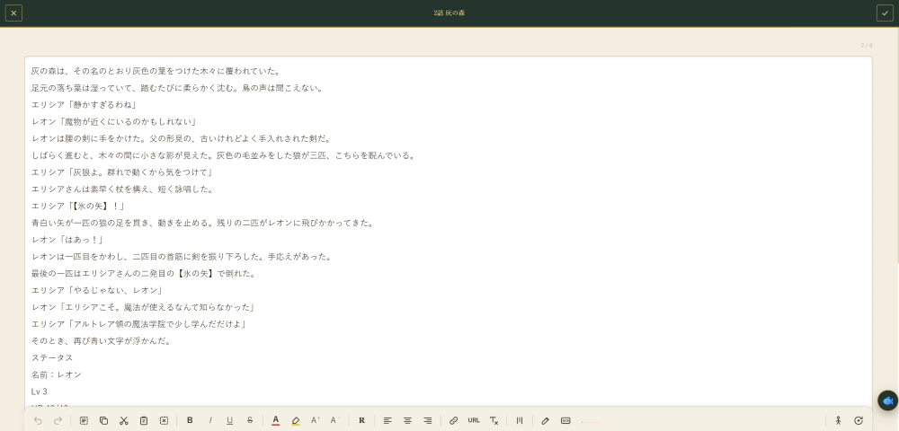

道具の並びです（左から）。

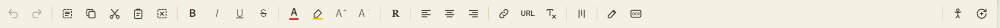

- **元に戻す・やり直す**
- **全選択・コピー・切り取り・貼り付け・選択解除**
- **太字・斜体・下線・取消線**
- **文字色・マーカー・大きく・小さく**
- **ルビ**：読み方を、ふりがなにします。
- **左揃え・中央揃え・右揃え**
- **リンク**（選んだ文字にリンクをはる）・**URL**（アドレスをそのまま入れる）・**装飾を消す**（選んだ範囲。選んでいなければ、本文ぜんぶ）
- **縦書きにする**
- **ここだけ編集**（えんぴつ）：選んだ文字を、窓で直します（次の項目）。
- **OCR**：画像から、文字を読み取ります。
- 右はし：**特殊な文字**（人のマーク）、**特殊演出**（回転する矢印と星のマーク）。（あとの項目で説明します。）
- 「本文を整える」で、行のつなぎ・記号をそろえます。

## 2. ここだけ編集

編集画面に行かなくても、**読む画面から、直したいところだけ**を直せます。

- 読んでいて、直したい文字を選ぶと、右下に、「ここだけ直す」が出ます。
- 押すと、**選んだ場所を含む1つの段落だけ**が、いつもの編集画面で開きます。太字・ルビ・特殊な文字などの**道具も、そのまま使えます**。
- 直したら、上の **「✓」** を押します。その段落だけが、本文に入れ替わります。**「×」** で、やめられます（本文は、変わりません）。
- ほかの話に移ったあとは、保存されません。直したら、すぐ「✓」を押してください。

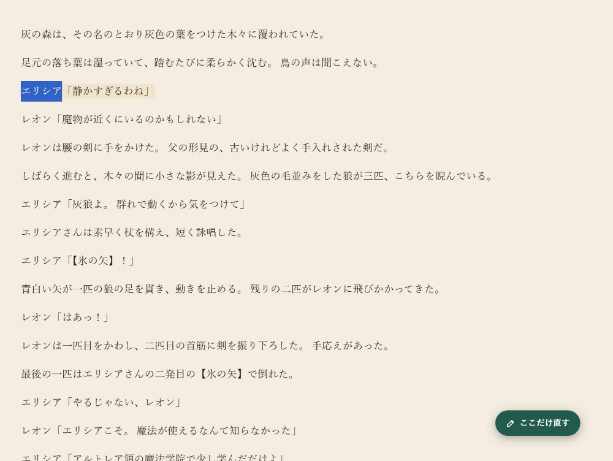

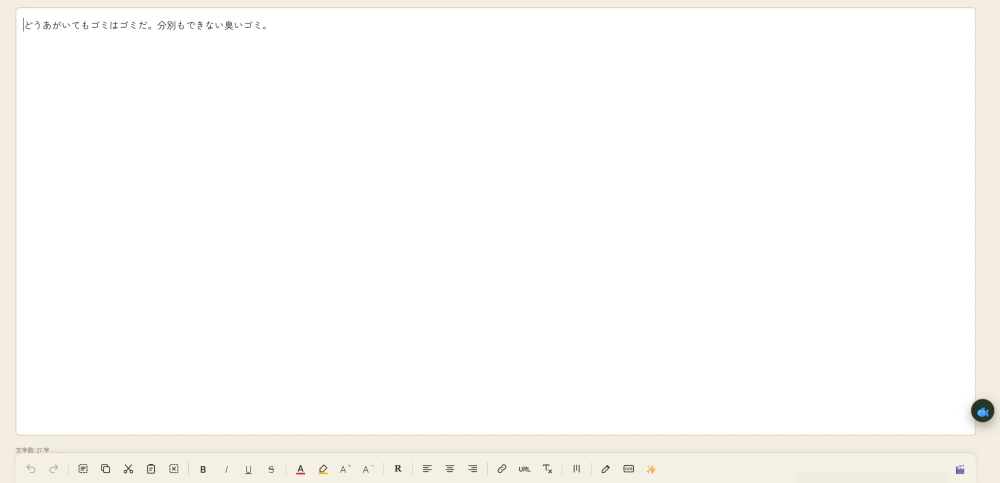

## 3. 特殊な文字

文字の向きを、変えます。**先に、文字を選んでから**、道具の右はしの、**人のマーク**を押します。

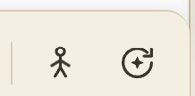

- 「特殊な文字」の窓が開きます。選んだ文字に、かけます。文字を選んでいないときは、いまの行の、次の1行にかけます。
- 種類：縦書き（この部分だけ）／ななめ（右下がり）／ななめ（左下がり）／左右反転／上下反転／回転（90度。角度は、印の「角度=数字」で変えられます）／逆さ（180度）。
- 「やめる」で、閉じます。

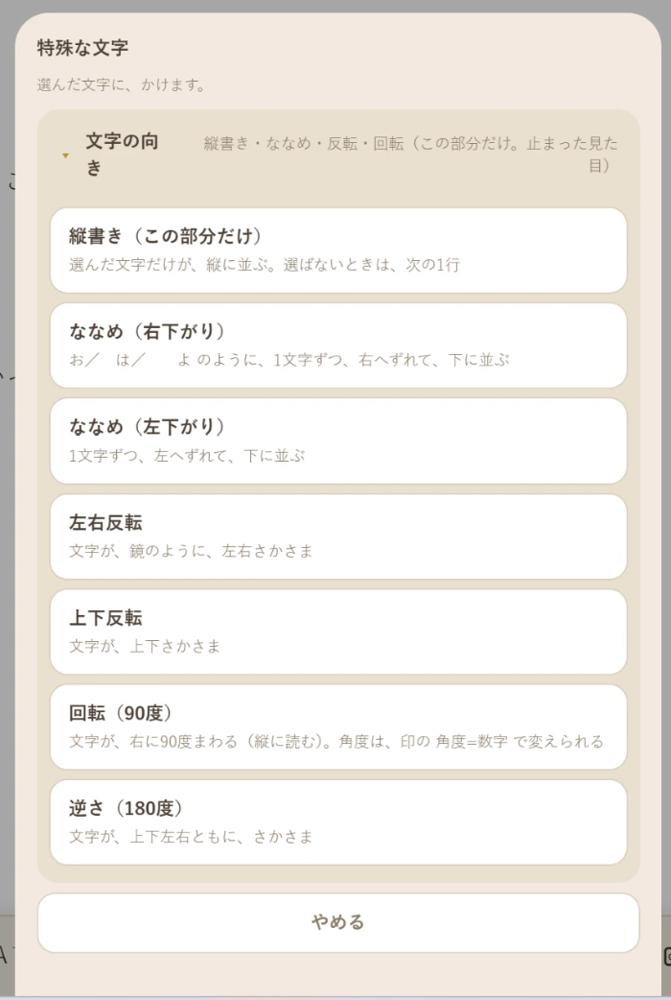

## 4. 特殊演出

ゲームの画面・チャット・掲示板などの、**枠**を、本文に入れます。**入れたい場所**にカーソルを置いて、**回転する矢印と星のマーク**を押します。

- 文字を選んでいないときは、**空の枠**が入ります（あとで、中に打ち込めます）。
- 種類：音・振動／流れる文字・案内板／ホラー・ぐちゃぐちゃ／システム画面／ゲームの画面（クエスト・アイテム購入・ステータス）／チャット・通知／1行の通知／掲示板。
- 例：「クエスト画面」を選ぶと、金色の枠の「［窓 色=金 名=クエスト］ 題： 内容： 報酬： 期限： ［／窓］」が入ります。題や内容を、あとで、書きます。
- 動く演出は、読む画面の上の🎬で見ます。
- **くわしい書き方は、「特殊演出の書き方」を見てください**（同じフォルダの `effects.pdf` / `effects.docx`）。

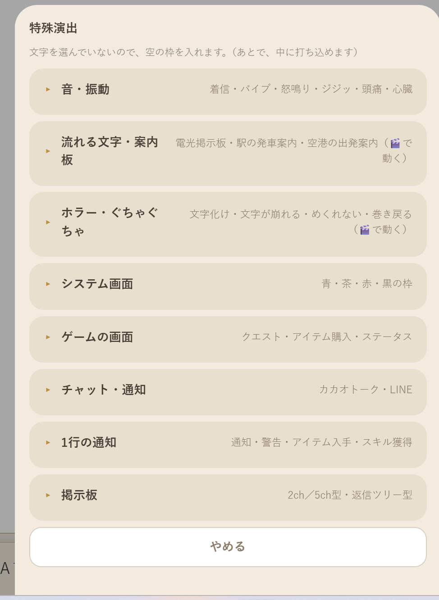

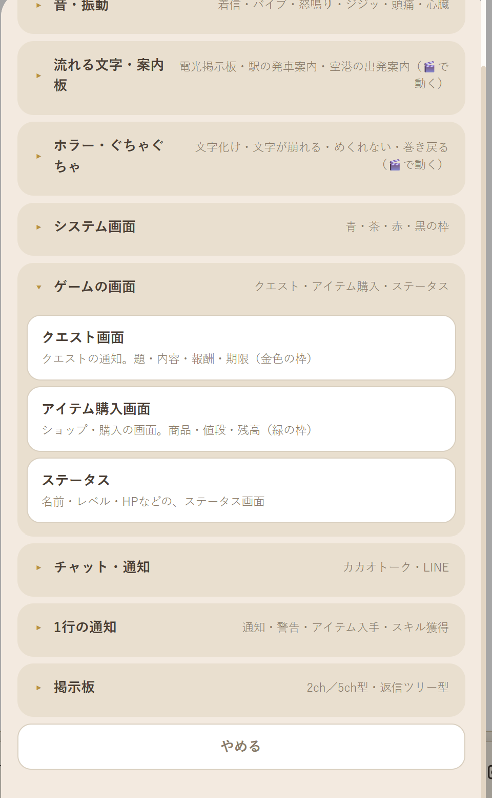

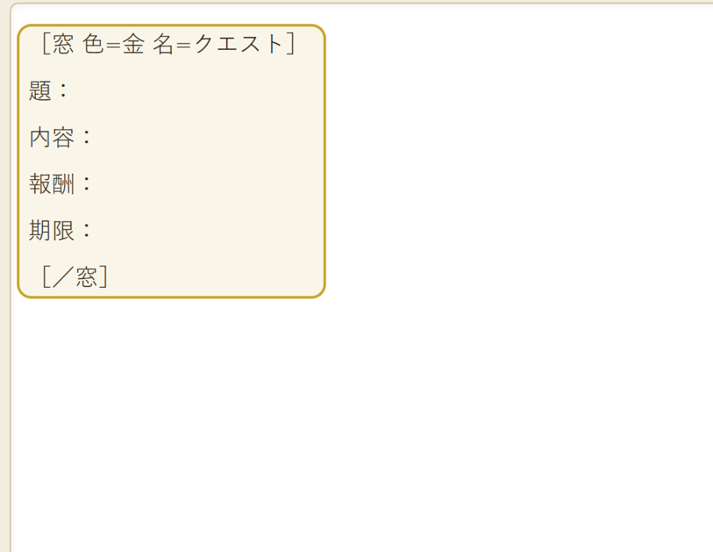

## 5. 音読

- 読む画面の上のバー（左から：本・スピーカー・検索・コメント・えんぴつ・歯車）の、**スピーカー**を押すと、音読が始まります。
- 音読のバーが出ます：前へ／一時停止・再生／次へ／速さ（1.0×）／閉じる（×）。左の点々（⋮⋮）を持って、**好きな場所に動かせます**。魚のボタンも、同じく、動かせます。
- 読んでいる文は、本文の中で、色が付きます。

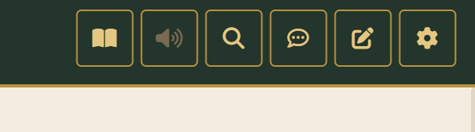

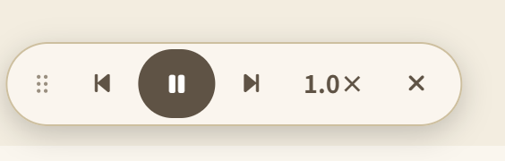

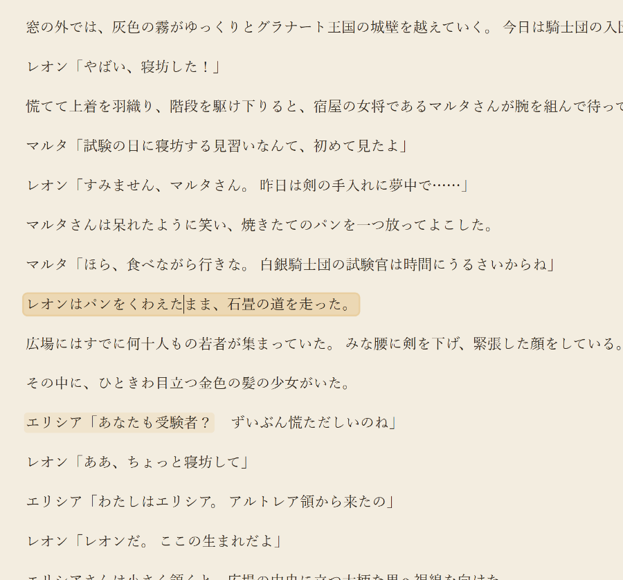

**音声朗読設定**は、読書環境の手帖（歯車）の中にあります。

- **読み上げ音声**：「Google 日本語（推奨）」などから選びます。「試聴」で、聞けます。
- **音声エンジン**：ブラウザ／端末の声。
- **連続再生**：次の話を、自動で再生します。
- **作品名の読み上げ**：「読まない（本文から開始）」「初回だけ読む（推奨）」「毎回読む」。
- **話数・章タイトルを本文前に読む**：チェックで、入れたり切ったりします。

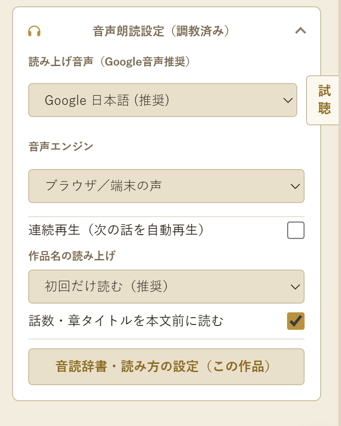

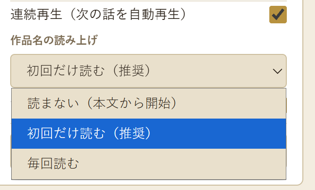

## 6. 作品を開いたときの、上のバーと、作品メニュー

作品の詳細の画面の、右上に、4つのボタンがあります（左から）。

- **虫めがね**：この作品を検索します（本文・コメント・Wiki…）。
- **3本線に丸**：作品の詳細設定（ジャンル・音読・wiki）。
- **開いた本**：読書ノート（進捗・メモ・感想）。
- **縦の3つの点**：作品メニュー。

**作品メニュー**（縦の3つの点）の中身です。

- **Googleドキュメントに書き出す**：本文だけ（演出・ルビは入りません）。Driveの「読書リーダー(仮)」に作ります。Googleの設定が必要です。
- **読書ノートを開く**
- **目次の番号**：目次形式・通し番号・部ごと。
- **置換辞書（ローカライズ）**
- **作品の詳細設定（ジャンル・音読・wiki）**
- **作品を削除する**

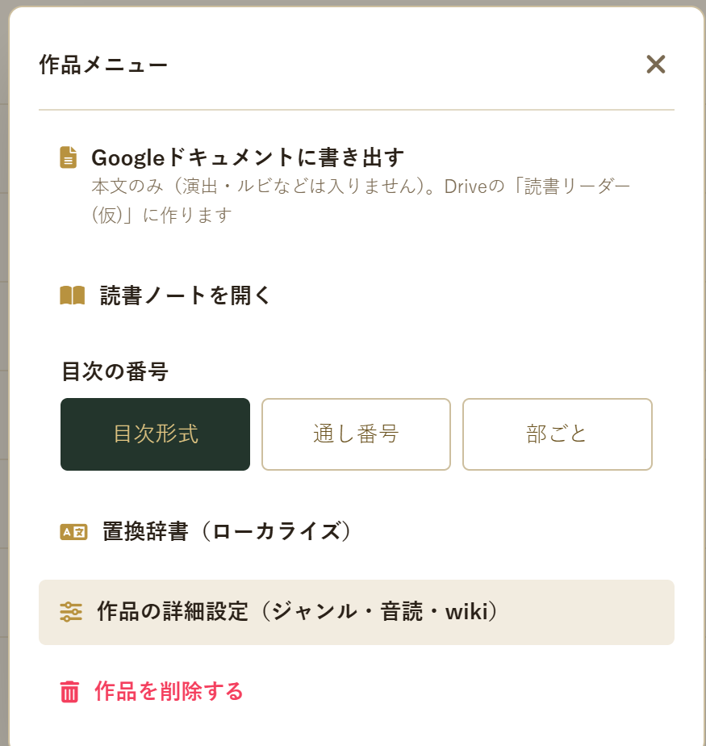

**読書ノート**には、次のものを書けます。

- 読書進捗（％）
- 読書メモ・気になる伏線
- 作品全体の感想・レビュー
- 書いたら、「ノートを保存」を押します。

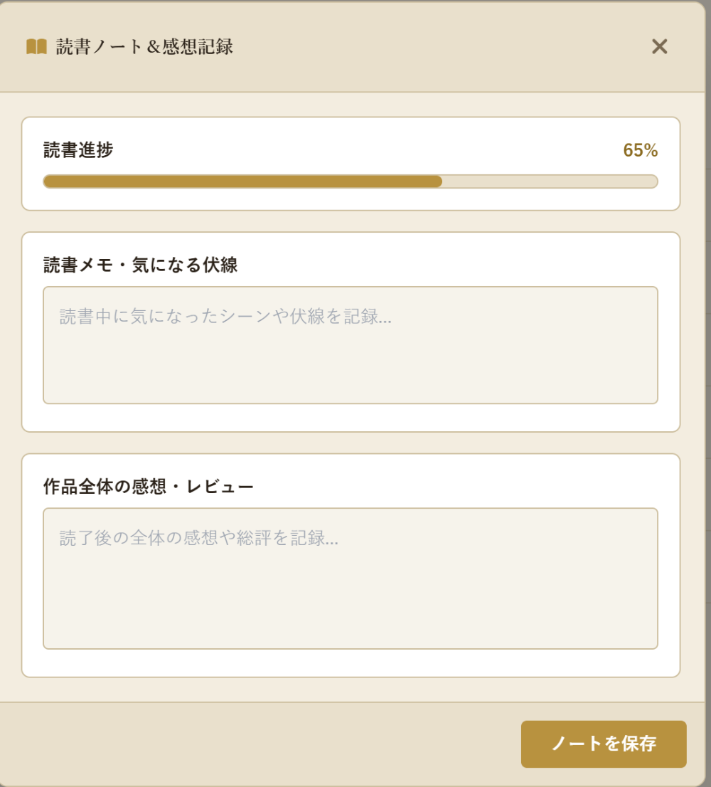

## 7. 作品の詳細設定

作品メニューか、詳細の上のバー（3本線に丸）か、魚のメニューから、開きます。作品ごとの設定です。

- **ジャンル（混ぜて選べます）**：音読や言葉拾いの目印です。「ファンタジー＋ロパン」のように、複数選べます。「システム系」を選ぶと、ステータスなどを、音読向けに読み替えます。（本棚の「分類」の、ジャンル（1つ）とは、別のものです。）
- **スキルの囲み記号（システム系）**：【】《》〈〉『』「」から、選びます。
- **音読：記号・ネット表現**
- **音読辞書（この作品）**：この手引きでは、くわしい説明を省きます。
- **読み方を試す**
- **言葉の自動拾い（wikiの仮登録）**：「共通（入）／入／切」から選びます。読み終えた話から、新しい言葉を拾って、仮登録の候補に出します。
- **特殊演出（この作品）**
- **置換辞書（ローカライズ）**
- **共通の設定を開く**

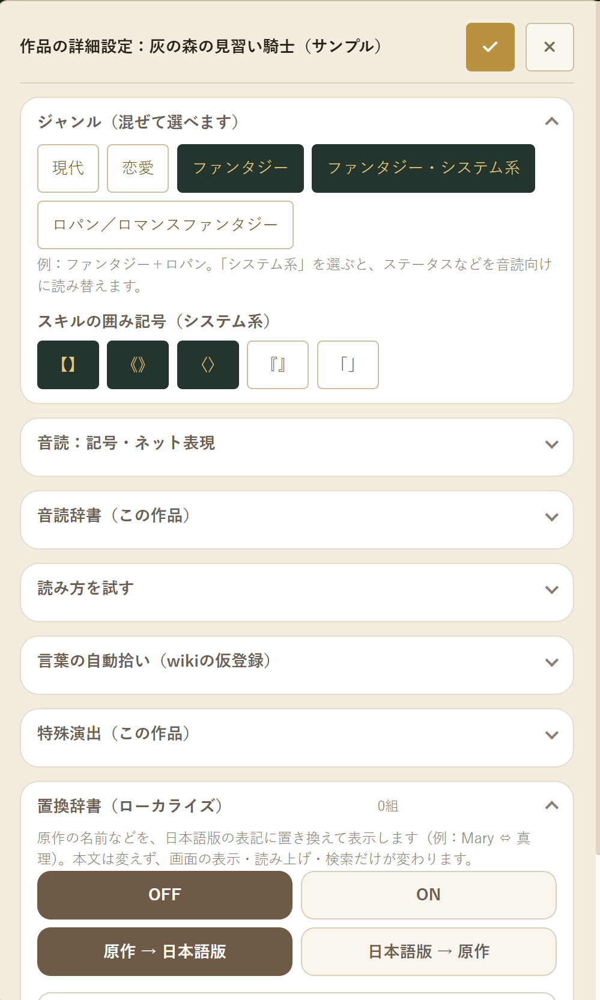

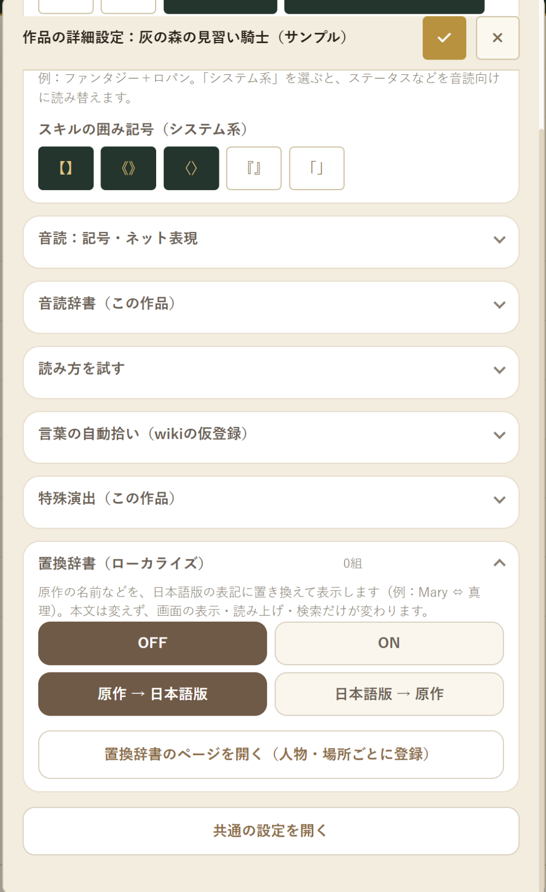

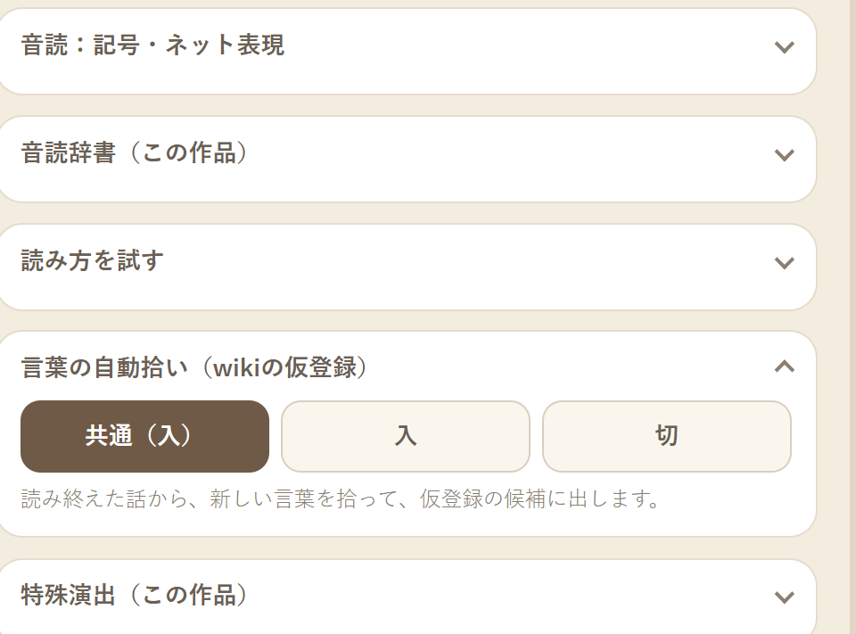

## 8. タグとジャンルの違い

作品の詳細の「年・分類」で、分類を足せます。**「タグ」と「ジャンル（1つ）」**を、使い分けます。

- **ジャンル（1つ）**：1冊に、**1つだけ**付けられます（金色の印）。例：ファンタジー。本棚の並びを「ジャンルごと」にすると、見出しになります。
- **タグ**：**いくつでも**付けられます（緑の印）。例：転生・憑依、アクション。読んだ記録のランキングで、「ジャンル」として数えられるのは、こちらです。
- 迷ったら、タグにしておくと、あとから、いくつでも足せます。
- 「＋分類」を押すと、いままでの分類の候補が出ます。候補を押すと、その作品に追加されます（もう一度押すと、外れます）。金色の候補は、ジャンルとして付きます。
- 新しい名前は、入力の欄に書いて、「追加」を押します。保存先は、「タグ」か「ジャンル（1つ）」を選べます。

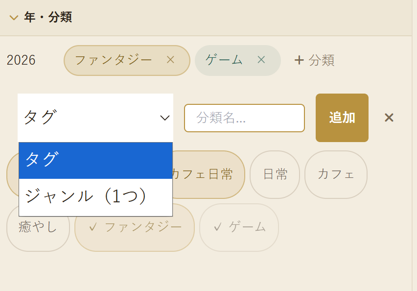

## 9. Wiki と、新しい言葉

Wikiは、人物・場所・用語などを、**作品ごと**に、まとめる機能です。魚のボタンから、開きます。

- **魚のボタン**：作品の画面では、「この作品のwikiを開く」。読む画面では、「Wikiを開く」。本棚では、「Wiki（作品ごと）」です。
- **赤い点**：魚の右上の赤い点は、「新しい言葉が、見つかった」という印です。メニューに、「新しい言葉（○件）」が出ます。（言葉は、作品ごとに、別々に持っています。）

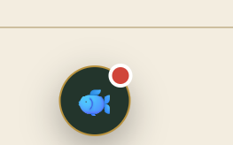

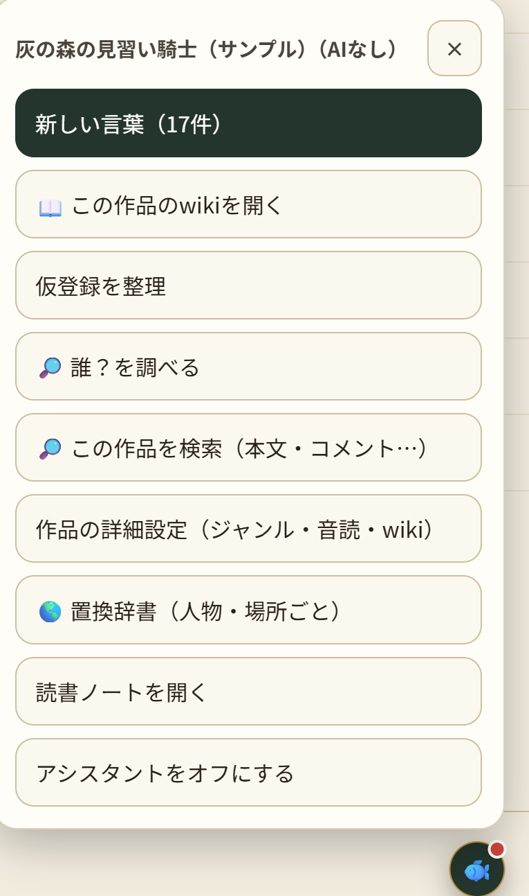

**新しい言葉**を、仮登録します。

- 読み終えた話から、人物・場所・組織・アイテム・スキルなどを、拾って、一覧にします。
- 「**要らない言葉だけ、チェックを外して**」ください。
- 「**チェックしたものを仮登録**」で、仮登録します。「今回はしない」で、そのままにします。「全部捨てる」で、捨てます（あとで、「捨てた言葉を見る」から、見られます）。
- ステータス画面の言葉（名前・Lv・HP・MP・スキル）は、**人物を選んで、「追記する」**で、その人物に足します。先に、人物を、Wikiか仮登録に入れておく必要があります。

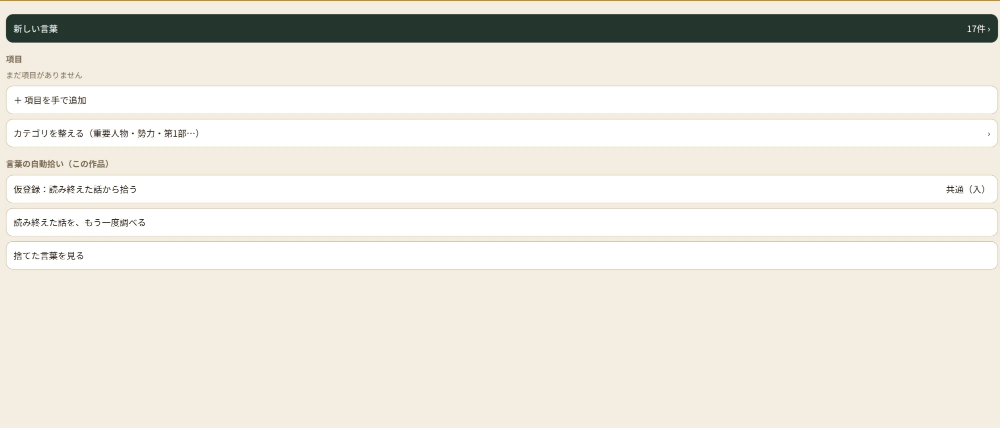

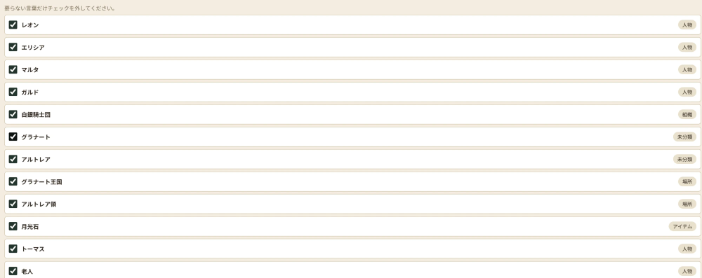

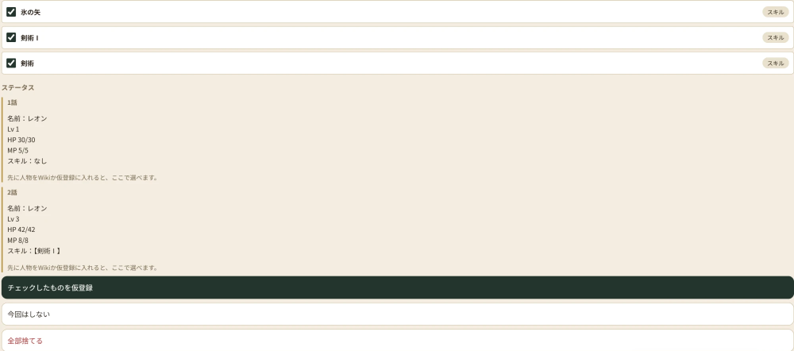

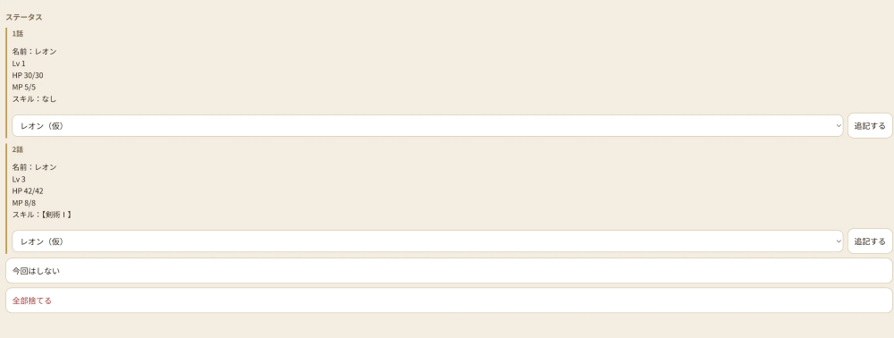

**項目を直す**（Wikiの1つの項目）。

- **名前**、**カテゴリ**（人物など。新しいカテゴリも足せます）、**基本情報**（いつでも見られる）。
- **項目の欄**（ステータス・所持品・スキル・関係・自由な欄）は、**使うものだけ**、足します。
- **進行度別情報（ネタバレ防止）**：「話」を入れると、**その話まで読み進めたら、見えます**。まだ読んでいない話の内容は、ロックされて、伏せられます（「現在の進捗（1話）より先の設定です。タップでネタバレを表示」）。
- あとから足したいことは、「あとから追記する内容」と、「判明した話数」を入れて、「追記を追加」を押します。
- 最後に、「保存して閉じる」。「削除」で、その項目を消します。

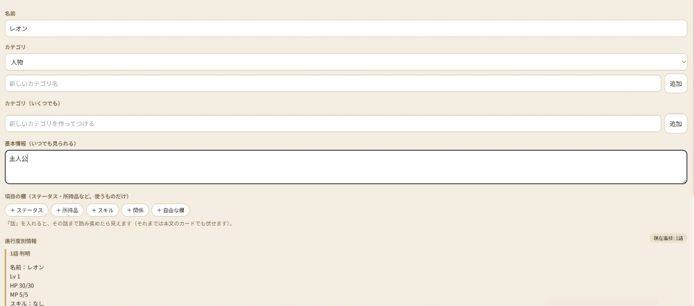

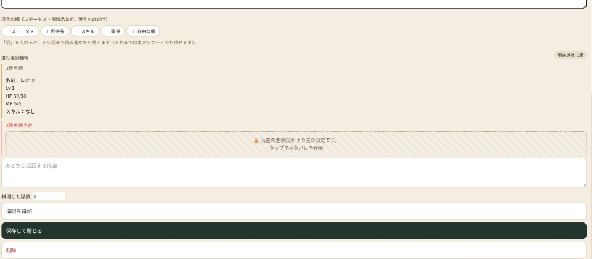

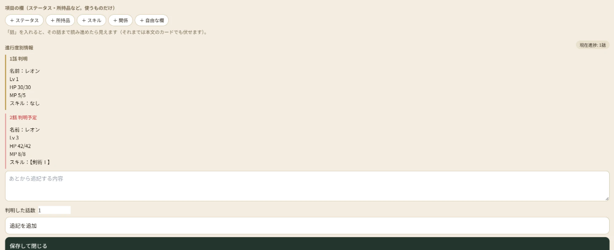

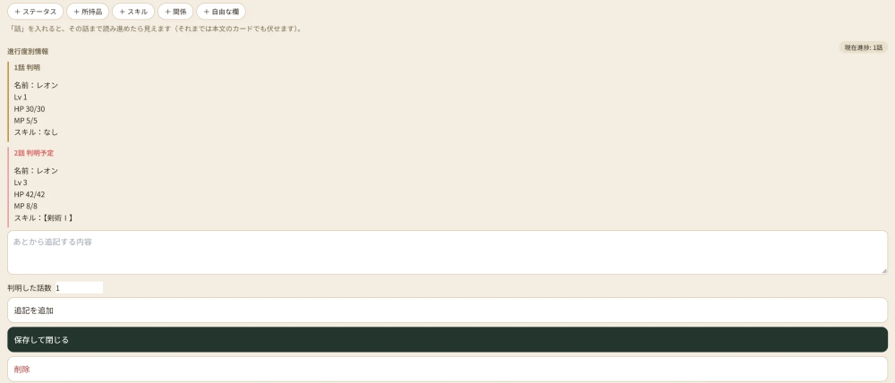

## 10. 置換辞書（ローカライズ）

翻訳された作品などで、**原作の名前を、日本語版の名前に置き換えて、表示します**（例：Mary ⇔ 真理）。

- **本文は、変わりません。** 画面の表示・読み上げ・検索だけが、変わります。
- 作品ごとに、「OFF（原作のまま）」「ON（置き換えて表示）」を選びます。向きは、「原作 → 日本語版」「日本語版 → 原作」です。
- 「置換辞書のページを開く」から、原作の名前と、日本語版の名前を、人物・場所などの種類を選んで、足します（「まとめて追加」で、1行に1組ずつ入れられます）。

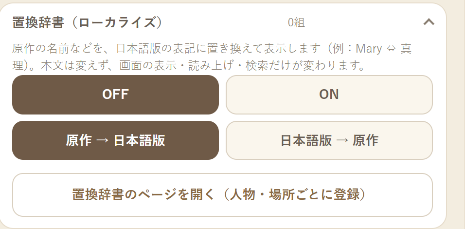

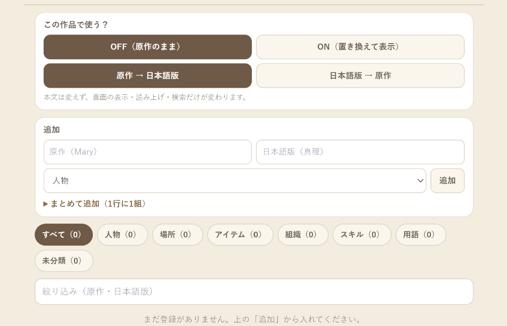

## 11. Wikiをくわしく使う（項目のページ・関連・年表・相関図）

Wikiの項目は、**読むためのページ**と、**書くための編集画面**に、分かれています。一覧で項目を押すと、ページが開きます。直すときは、右上の「✎」を押します。

### 項目のページ
- 名前、種類、時期、別の呼び方、基本情報、ステータス・スキルなどの欄、関連、経歴・変遷、追記が、まとまって出ます。
- **○話時点で見る**：ページの上の「表示する話数」を変えると、その話までの内容に切り替わります。同じ名前の欄（例：力）は、いちばん新しい値が出て、前の値は、「前の値」を押すと見られます。
- **ネタバレ**：いま読んでいる話より先の内容は、隠れます。先の話数を入れると、赤い文字で知らせます。

### 項目を編集する
- **別の呼び方（表記ゆれ）**：「田中P、田中PD、田中プロデューサー」のように、「、」か「,」で区切って、まとめて入れます。本文の色づけ、カード、検索が、同じ項目として反応します。ほかの項目と呼び方がかぶると、確認が出ます。
- **時期**：年と、月（なくても可）を入れます。年表に使います。
- **関連する項目**：「＋ 関連を足す」で、ほかの項目をつなぎます。関係の名前（所属・後輩・出演など）と、「向こう側の呼び名」（例：「所属」⇔「所属者」）、ひとこと（役名・ポジションなど）、「○話から見える」を入れられます。
  - つながりは、**双方向**です。向こうの項目にも、自動で出ます。
  - 数に制限は、ありません。「所属」を、いくつでも付けられます。
- **出来事・功績**：年・月・出来事を、足します。人物のページの「経歴・変遷」に、関連のある作品（出演ドラマなど）と、いっしょに、時期の順に並びます。「○話から見える」で、ネタバレも守れます。
- **追記**：ふだんは読むだけです。直すときは、追記の右の鉛筆を押します。「この追記を消す」もあります。「追記を追加」を押さなくても、保存すると、書きかけの追記が入ります。
- 上の「✓」で保存して、ページに戻ります。変更があるのに、保存せずに戻ると、確認が出ます。

### 本文から、Wikiへ
- 読む画面で言葉を選ぶと、「ここだけ直す」の隣に、**「Wikiに登録」**が出ます。新しい項目にするか、すでにある項目の「別の呼び方」に足すかを、選べます（一覧は、タグごとに折りたたみです）。
- 名前を登録したり、別の呼び方を足したりすると、読む画面の色づけが、すぐ変わります。

### 文章の中のリンク
- 基本情報・追記・話のまとめなどの文章に、登録してある名前（別の呼び方も）が出ると、**自動でリンク**になります。押すと、小さなカードが開きます。
- `[[名前]]` と書くと、リンクになります。まだ項目が無い名前は、**赤い印**で出て、押すと、その名前で、新しい項目を作れます。
- 項目のページの「**この項目が、出てくるところ**」に、ほかの項目の説明、話のまとめ、本文に出る話が、並びます（先の話は、隠れます）。

### 年表と相関図
- Wikiの一覧の「**年表**」：項目の時期と、出来事を、古い順に並べます。種類でしぼれます。
- Wikiの一覧の「**相関図**」（項目のページには、「この項目の相関図」）：関連を、図にします。線の上に、関係の名前が出ます。「表示する話数」、中心にする項目、何つながりまで（1つ先・2つ先）、種類を選べます。名前を押すと、その項目のページが開きます。「Mermaidの文字を、コピーする」で、Mermaid形式の文字も、取り出せます。

### 種類のひな形
- 「カテゴリを整える」の下の、「項目の『種類』のひな形」で、「百科事典セット」（国家・都市／宗教・神／システム・職業・称号／契約・支配・信仰／作品／世界線）と、「追跡・分析セット」（伏線／功績・業績／考察）を、足せます。

## 12. 話のまとめ

各話に、**サブタイトル・あらすじ・注目ポイント・読書メモ**を、書き残せます。

- 魚のメニューの「📝 話のまとめ」から、一覧を開きます。読む画面では、「この話のまとめ」から、いまの話のまとめが開きます。
- 話を押すと、その話のまとめが開きます。右上の鉛筆で書き、「✓」で保存します。
- **範囲のまとめ**（1〜10話、など）も、書けます。
- 読み進めていない話のまとめは、隠れます（「ネタバレを見る」で見られます）。
- 文章の中の人物や用語は、Wikiの項目に、リンクします（`[[名前]]` も使えます）。
- 「この話を読む」で、その話が開きます。

## 13. 一括訂正（誤字・表記ゆれを、まとめて直す）

翻訳などで出る、誤字や表記ゆれを、**本文そのものを書き換えて**、まとめて直します（例：スホ、スンホ → スルホ）。

- 魚のメニューの「✏️ 一括訂正」を開きます。
- 「まちがい」の欄に、「、」で区切って、いくつでも入れ、「正しい形」の欄に、1つ入れます。別の人の直しは、「＋ 行を足す」で、足します。
- 範囲は、「この作品の全話」か、「いま開いている話だけ」です。「Wikiの名前・別の呼び方も直す」にチェックを入れると、Wikiの項目も、いっしょに直ります。
- 「確認」で、話ごとの件数が出ます（本文は、まだ変わりません）。「実行」を押すと、確認の窓が出て、「はい」で書き換わります。
- すでに正しいところ（例：「ユ・スルホ」の中の「スルホ」）は、二重に直しません。
- 「元に戻す」で、直前の一括訂正を、取り消せます。そのあとに、自分で直した話は、そのままにします。

## 14. Driveを、作品ごとのフォルダにそろえる

- 全体設定の「Driveを作品ごとのフォルダにそろえる」を押すと、Driveの中を、作品ごとのフォルダにして、**本体と、控えの新しい5件**を、入れます。それより古い控えは、Driveのごみ箱に送ります（30日は戻せます）。
- **パソコンもスマホも、すべて新しい版にしてから、押してください。** 古い版の端末は、フォルダの中の作品が、見えなくなります。
- そろえたあとの新しい控えは、作品のフォルダに入って、いつも新しい5件だけ残ります。
