# Google Drive の設定（くわしい版・画像つき）

> この文書は AI が書きました。画面の名前や並びは、Google や GitHub の変更で変わることがあります。少し違っても、同じ意味の場所を探してください。

短い説明だけでよい人は、[かんたん版](drive-setup.md) を見てください。

Google Drive と同期したい人だけ、この手順で自分用の設定を作ってください。使わない人は読まなくて大丈夫です。作品は、使っている端末の中に保存されます。

## 全体の流れ

1. Google のプロジェクトを作る
2. Google Drive API をオンにする
3. 同意画面を作る
4. クライアント ID を作る
5. アプリに ID を貼る
6. つないでみる

## おすすめの端末

Google Cloud の設定画面は、パソコンかタブレットで行うのがおすすめです。スマホは画面が狭く、文字がつぶれたりボタンがずれたりして、やりにくくなります。

スマホで行うときは、ブラウザのメニュー（「⋮」など）の「PC版サイト」にチェック（✅）を入れてから開いてください。「デスクトップ向けサイト」と書いてあることもあります。パソコンと同じ画面になります。

## 用意するもの

- Google アカウント（ふだん使っているもので大丈夫です）
- アプリのアドレス（次のものを使います。自分のアドレスを作りたい人は、一番下の「自分のアドレスを作りたい人へ」を見てください）

      https://to-hu59.github.io/minimal-editor-dist/

## 近道のリンク

押すと、その画面に行けます。

- [プロジェクトを作る](https://console.cloud.google.com/projectcreate)
- [Google Drive API をオンにする](https://console.cloud.google.com/apis/library/drive.googleapis.com)
- [同意画面（Google Auth Platform）](https://console.developers.google.com/auth/branding)
- [クライアントを作る](https://console.developers.google.com/auth/clients)

プロジェクトを作ったあとは、画面上部のプロジェクト名が「作ったプロジェクト」になっているか確認してから押してください。

## 1. Google のプロジェクトを作る

### 画面の見かた

Google Cloud の画面には、最初にお金の案内（「無料トライアルを試す」「無料で始める」など）が出ます。どれも押さなくて大丈夫です。パソコンでもタブレットでもスマホでも出ます。無視してください。この設定だけなら、お金は必要ありません。

**スマホの場合**

お金の案内が出る画面は、いつものホーム画面の一番上の部分です。下にスクロールすると、ふつうのホーム画面が続いています。案内はただの宣伝なので、気にせず「≡」から先へ進みます。

アドレスを直接開くと、1 回で行けます（おすすめ）。

1. ブラウザで、次のアドレスを開きます。検索はしません。

   👉 [https://console.cloud.google.com/](https://console.cloud.google.com/)

   お金の案内のページが出ます。そのまま 2 へ進みます。

2. 左上の「≡」（赤い四角）を押します。

   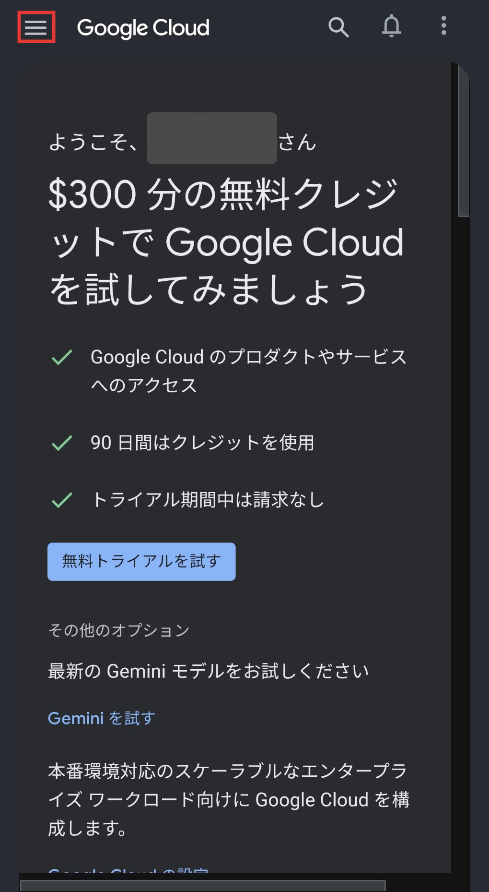

   *▲ 左上の「≡」を押します（お金の案内は無視）*

3. いつもの画面（プロダクトの一覧）が開きます。ここまで来れば、あとはパソコンと同じです。「API とサービス」（赤い四角）は、手順 1〜4 でも使います。

   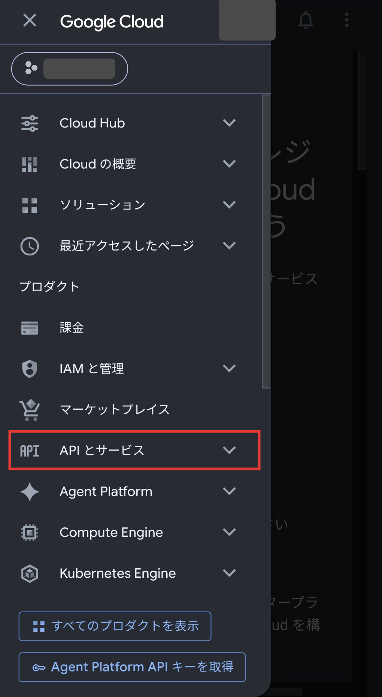

   *▲ いつもの画面です。「API とサービス」はここにあります*

検索して開いたときは、宣伝のページが出ます。その場合は、次のようにします。

1. 宣伝のページの左上にある「≡」（赤い四角）を押します。

   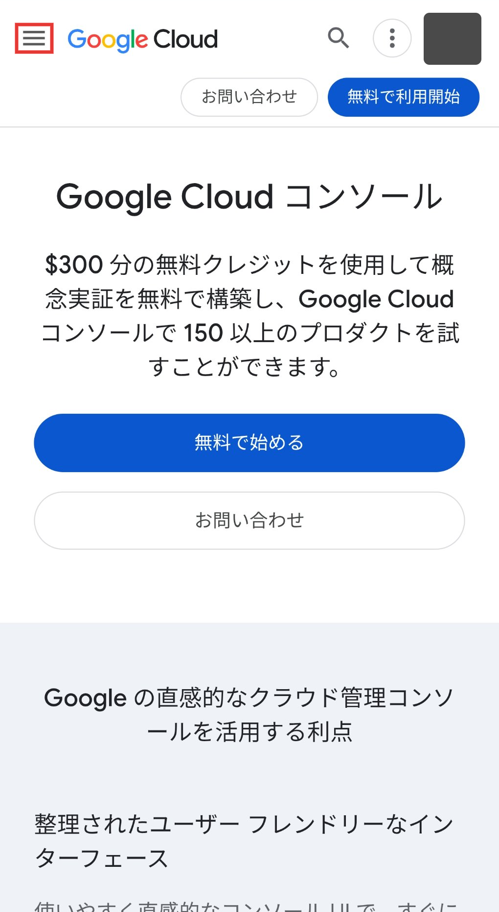

   *▲ 左上の「≡」を押します*

2. 開いたメニューの一番下の「コンソール」（赤い四角）を押します。

   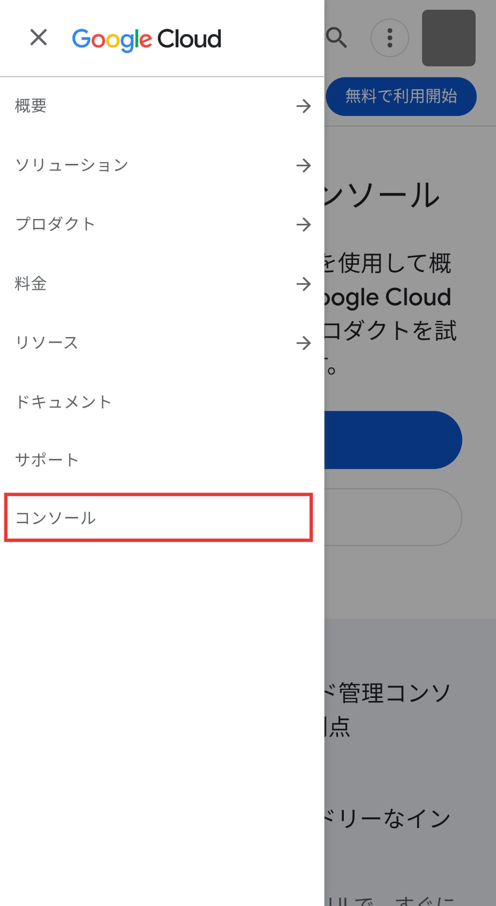

   *▲ 一番下の「コンソール」を押します*

3. お金の案内のページが出ます。もう一度、左上の「≡」を押すと、いつもの画面が開きます。

**パソコン・タブレットの場合**

1. 「Google Cloud コンソール」を開いて、Google アカウントでログインします。
2. 最初に、「無料トライアルを試す」などのお金の案内が出ます。押さずに無視してください。

   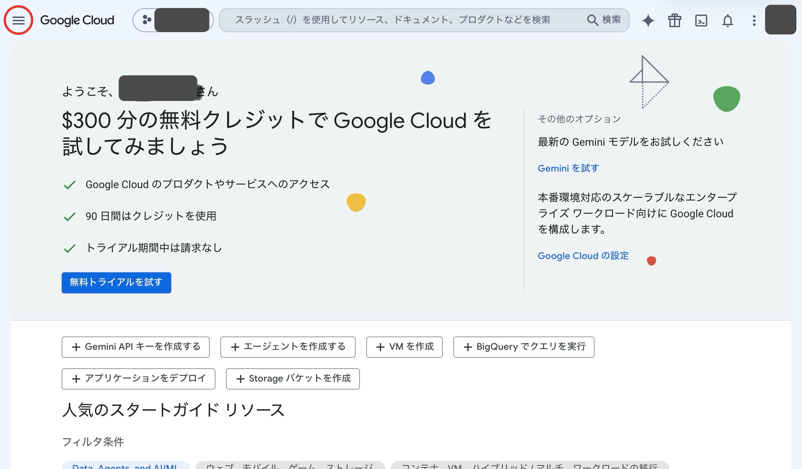

   *▲ 丸のところ（左上の「≡」）を押します*

3. 左上の「≡」（三本線のマーク）を押します。左にメニューが開きます。
4. メニューの「API とサービス」を押すと、右に 4 つの項目が出ます。

   - 有効な API とサービス
   - ライブラリ（手順 2 で使います）
   - 認証情報（手順 4 で使います）
   - OAuth 同意画面（手順 3 で使います）

   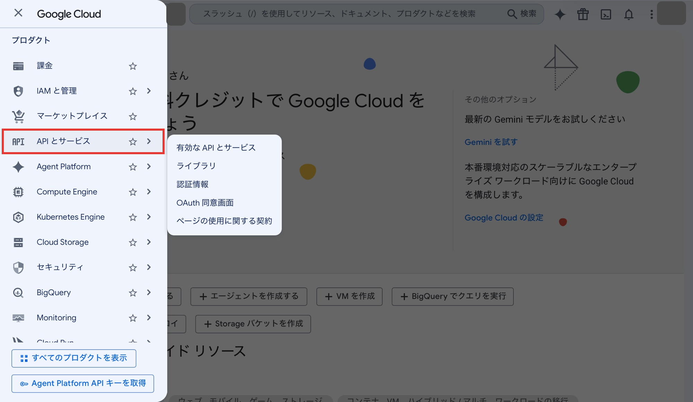

   *▲ 「API とサービス」を押します*

以降の手順で「API とサービス」と書いてあるのは、このメニューのことです。

> メニューの「課金」は、押さないでください（「API とサービス」よりずっと上にあります）。押すと、お金の画面に行ってしまいます。

> ホーム画面を下にスクロールすると、「＋ Gemini API キーを作成する」「＋ VM を作成」などのボタンが並んでいます。これらも押さないでください。押すと、お金の画面（請求先アカウントの作成）に行ってしまいます。「API」は、必ず左上の「≡」→「API とサービス」→「ライブラリ」から探してください。

### プロジェクトを作る

1. 左上の「≡」を押して、メニューを開きます。その中の「IAM と管理」（赤い四角）に、マウスを合わせます。スマホでは押します。

   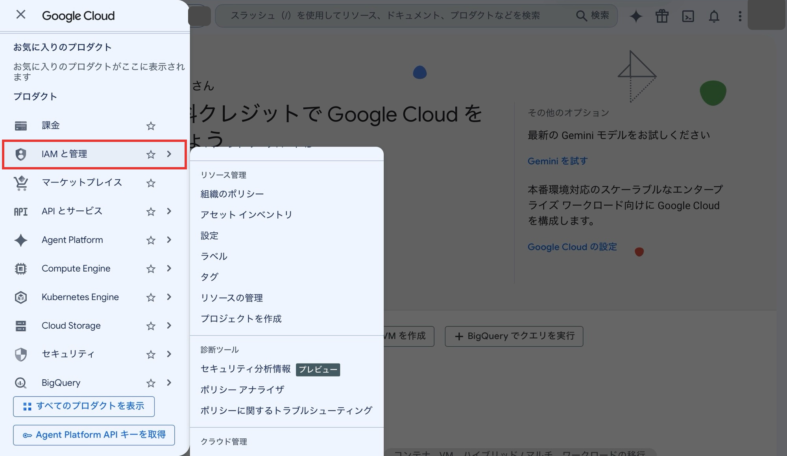

   *▲ 「IAM と管理」を押します*

2. 右に出る一覧の「プロジェクトを作成」（赤い四角）を押します。

   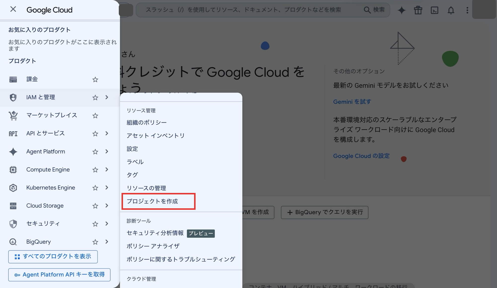

   *▲ 「プロジェクトを作成」を押します*

スマホの場合は、上の 1〜2 のかわりに、次のどちらかの方法で作ります。やりやすいほうで大丈夫です。そのあと、下の 3 へ進みます。

**方法 A：「IAM と管理」から**

1. 左上の「≡」を押して、メニューを開きます。「IAM と管理」（赤い四角）を押します。

   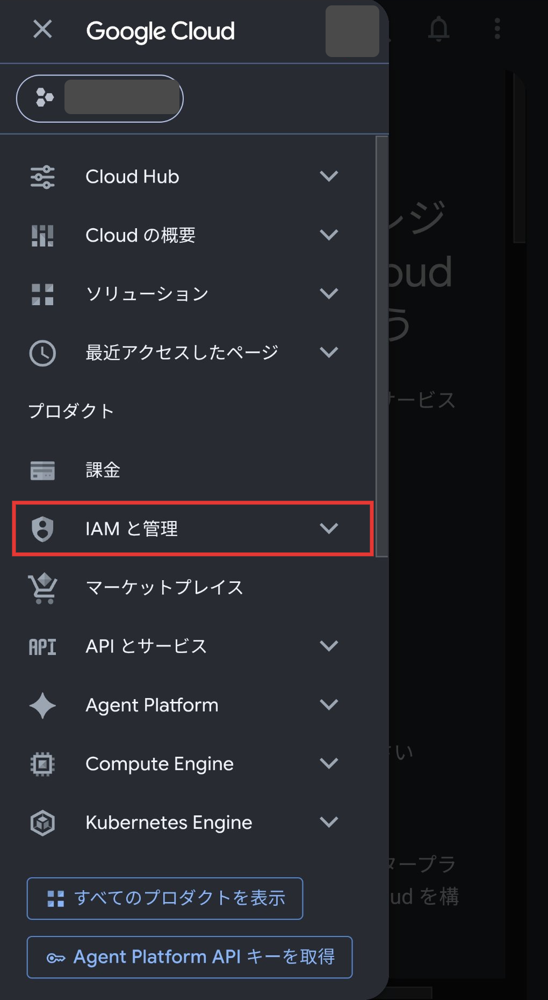

   *▲ 「IAM と管理」を押します*

2. 一覧が開きます。少し下にスクロールして、「プロジェクトを作成」（赤い四角）を押します。

   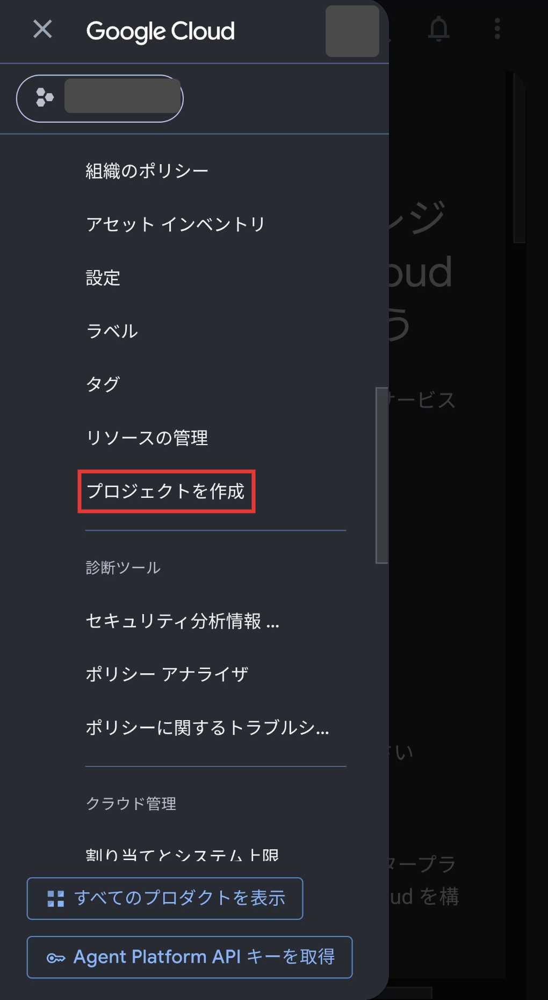

   *▲ 下にスクロールして、「プロジェクトを作成」を押します*

**方法 B：プロジェクトの名前のところから**

1. 左上の「≡」を押して、メニューを開きます。上にあるプロジェクトの名前のところ（赤い四角）を押します。

   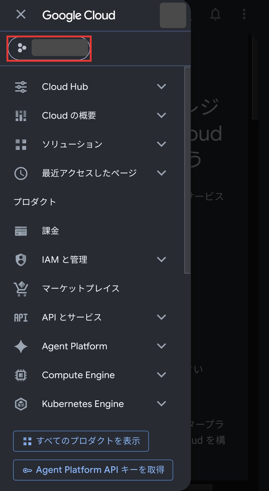

   *▲ 上のプロジェクトの名前のところを押します*

2. 「リソースを選択」の窓が開きます。右上の「⋮」（点が 3 つ）を押して、一覧の「新しいプロジェクト」（赤い四角）を押します。

   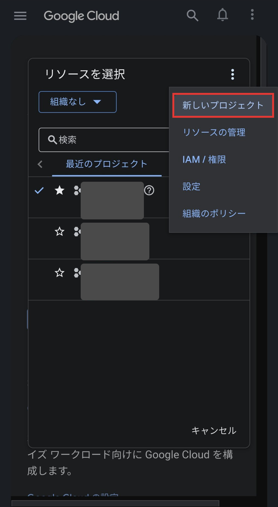

   *▲ 右上の「⋮」を押して、出てきた「新しいプロジェクト」を押します*

3. 「新しいプロジェクト」の画面が開きます。「プロジェクト名」（赤い四角）に、好きな名前（例：my-reader）を入れます。最初から「My Project 12345」のような名前が入っているときは、そのままで大丈夫です。

   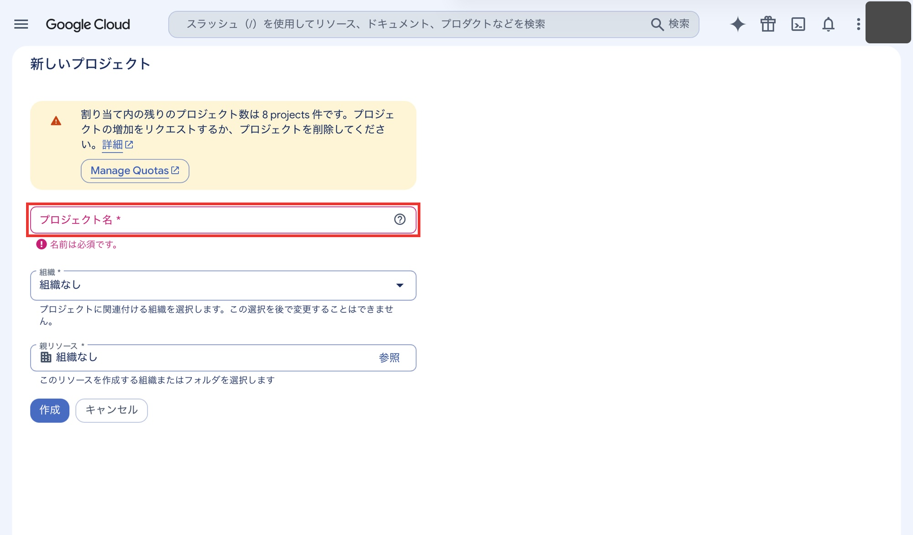

   *▲ 「プロジェクト名」に、好きな名前を入れます*

   - その下の「プロジェクト ID」は自動で決まります。あとで変えられませんが、このアプリでは使わないので気にしなくて大丈夫です。
   - 「組織」は「組織なし」のままで大丈夫です。
   - 上に黄色い案内（「割り当て内の残りのプロジェクト数は…」）が出ることがあります。残りが 1 以上なら、そのまま進めて大丈夫です。

4. 「作成」（赤い四角）を押します。

   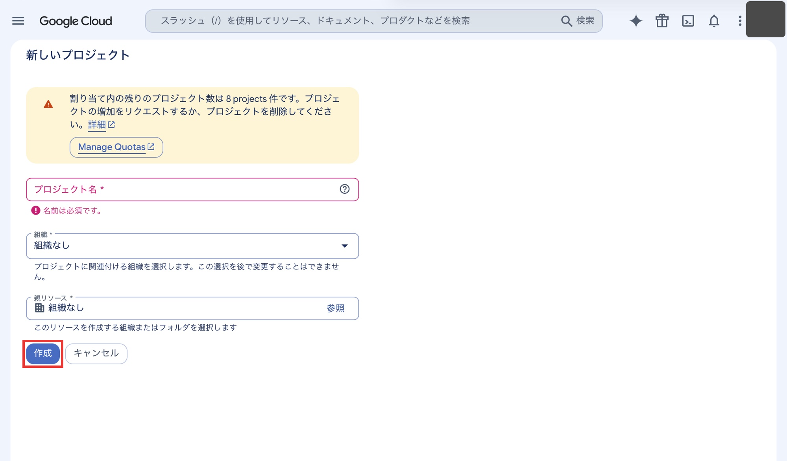

   *▲ 名前を入れたら、「作成」を押します*

5. 数秒でプロジェクトができます。上のプロジェクト名のところに、いま作った名前が出ていることを確認します。

   近道：[「新しいプロジェクト」の画面を開く](https://console.cloud.google.com/projectcreate)

### 【大事】上の名前が、作ったプロジェクトか確認する

画面上部のプロジェクト名は、「いま選ばれているプロジェクト」です。ここが作ったプロジェクトになっていないまま進むと、別のプロジェクトに設定してしまいます。

**いちばん簡単な切り替え方（通知から）**

「作成」を押したあと、右上の「🔔」（ベルのマーク）に、数字の「1」がつきます。

1. 右上の「🔔」を押します。「プロジェクトを作成します：（作った名前）」という通知が出ます。
2. その下の「プロジェクトを選択」（赤い四角）を押します。

   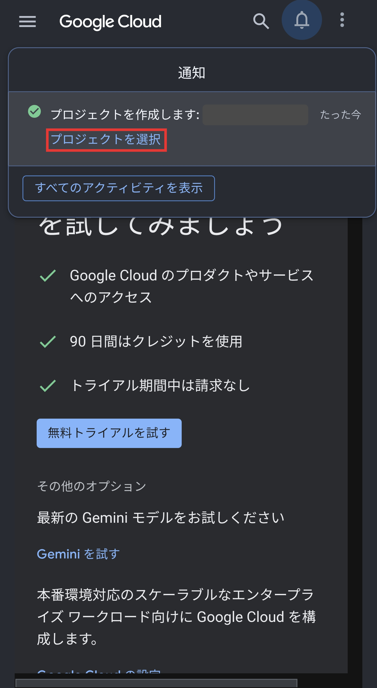

   *▲ 通知の「プロジェクトを選択」を押します*

3. 上の名前が、作ったプロジェクトに変わったことを確認します。

通知が消えているときは、次の方法で切り替えます。

**そのほかの切り替え方**

- 初めて使う人（プロジェクトが 1 つもなかった人）：作ったプロジェクトが自動で選ばれることが多いです。上の名前が作った名前になっていれば、そのまま手順 2 に進みます。「プロジェクトを選択」のままのときは、下の切り替えを行ってください。
- すでにプロジェクトを持っている人：「作成」を押したあとも、上の名前は前から持っているプロジェクトのままです。必ず次のように切り替えます。

  1. 上のプロジェクトの名前のところ（赤い四角）を押します。

     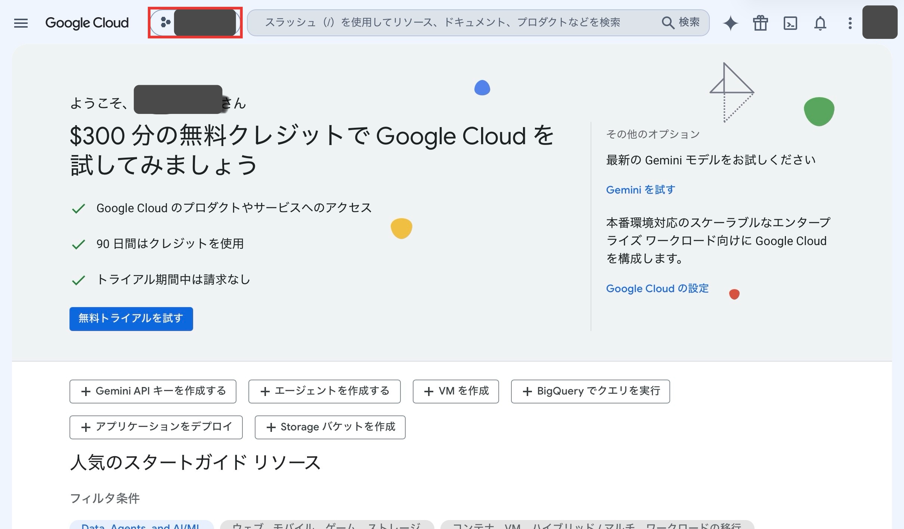

     *▲ 上のプロジェクトの名前のところを押します*

  2. 「リソースを選択」の窓が開きます。一覧（赤い四角）の中から、いま作ったプロジェクトの名前を押します。選ばれているものには、左に ✓ がついています。見つからないときは、上の検索欄に名前を入れてください。

     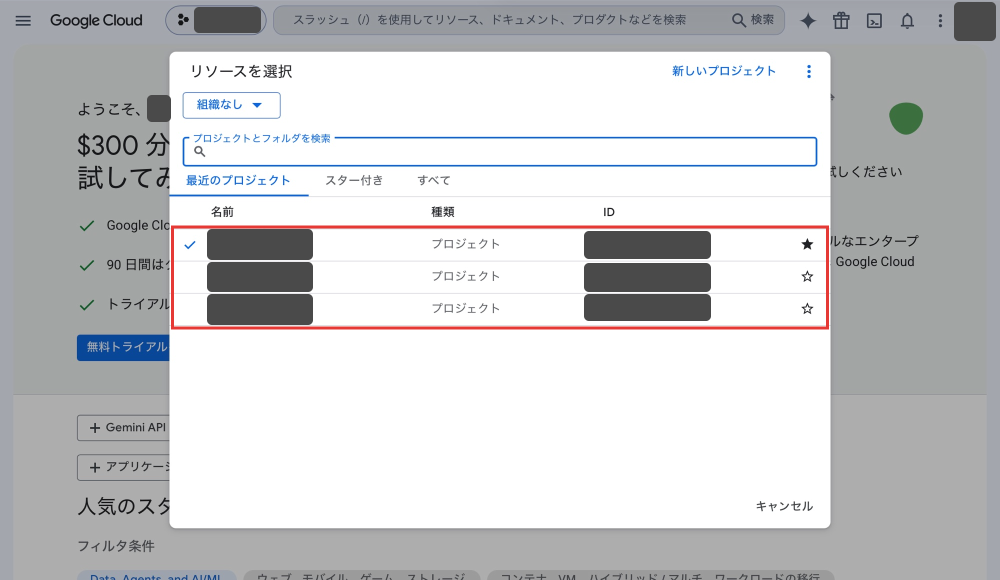

     *▲ 一覧の中から、いま作ったプロジェクトを押します*

  3. 上の名前が、作ったプロジェクトに変わったことを確認します。

  スマホの場合：左上の「≡」を押して、メニュー上部のプロジェクトの名前を押します（上の方法 B の 1 と同じ画面です）。出てきた一覧から、作ったプロジェクトの名前を押します。

## 2. Google Drive API をオンにする

**かんたんな方法**：次のリンクを押すと、探さなくても「Google Drive API」の画面が開きます。

👉 [Google Drive API の画面を開く](https://console.cloud.google.com/apis/library/drive.googleapis.com)

1. 上の名前が、手順 1 で作ったプロジェクトになっているか確認します。違うときは、手順 1 の切り替えを行ってから、もう一度リンクを押します。
2. 「Google Drive API」の画面が開きます。「有効にする」（赤い四角）を押します。隣の「この API を試す」は押しません。

   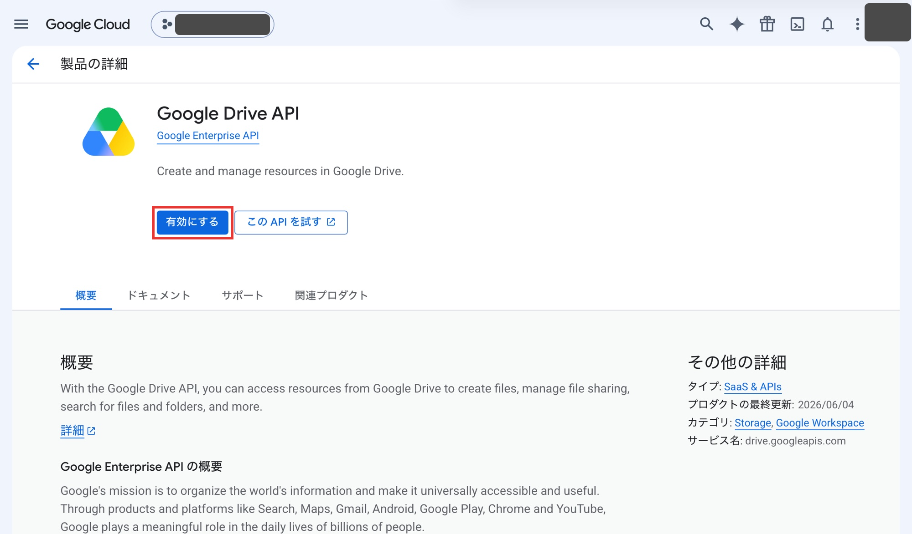

   *▲ 「有効にする」を押します*

   押したあと、パソコン・タブレットでは、ボタンが「管理」に変わり、「API が有効です」と出ます（赤い四角）。

   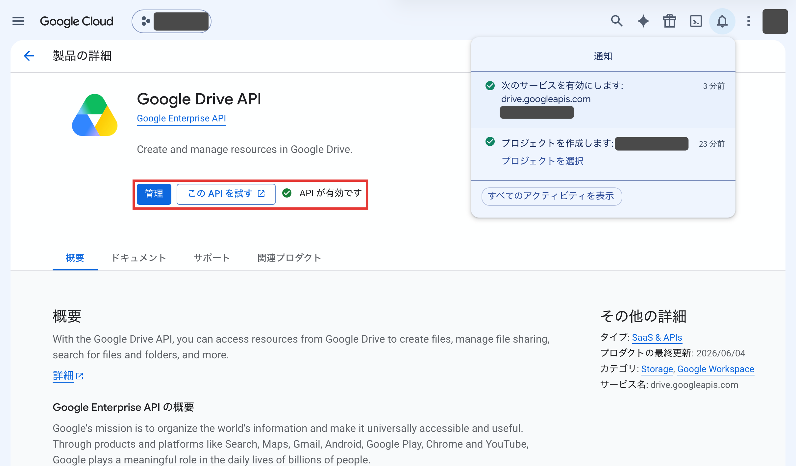

   *▲ 「API が有効です」と出れば、できています*

3. 数秒すると、右上の「🔔」に「1」がつきます（赤い四角）。

   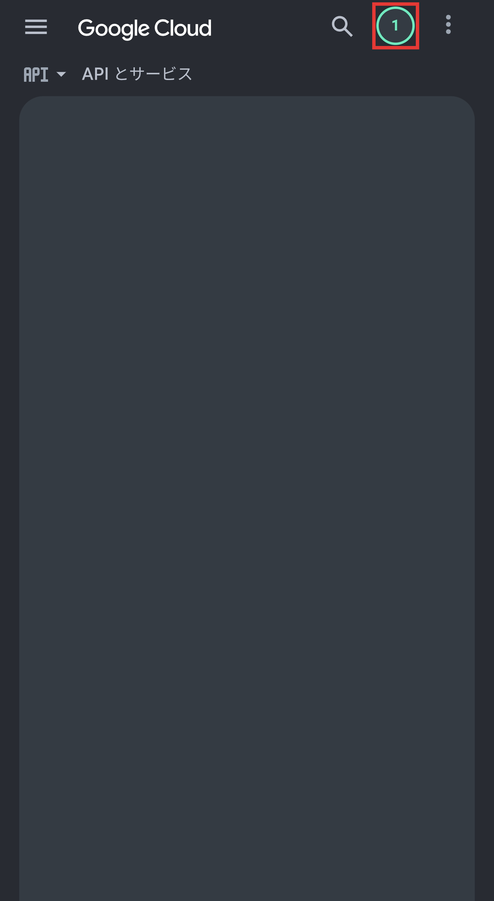

   *▲ 右上の「🔔」に「1」がつきます*

4. 「🔔」を押すと、「次のサービスを有効にします：drive.googleapis.com」という通知が出ます（赤い四角）。✅がついていれば成功です。

   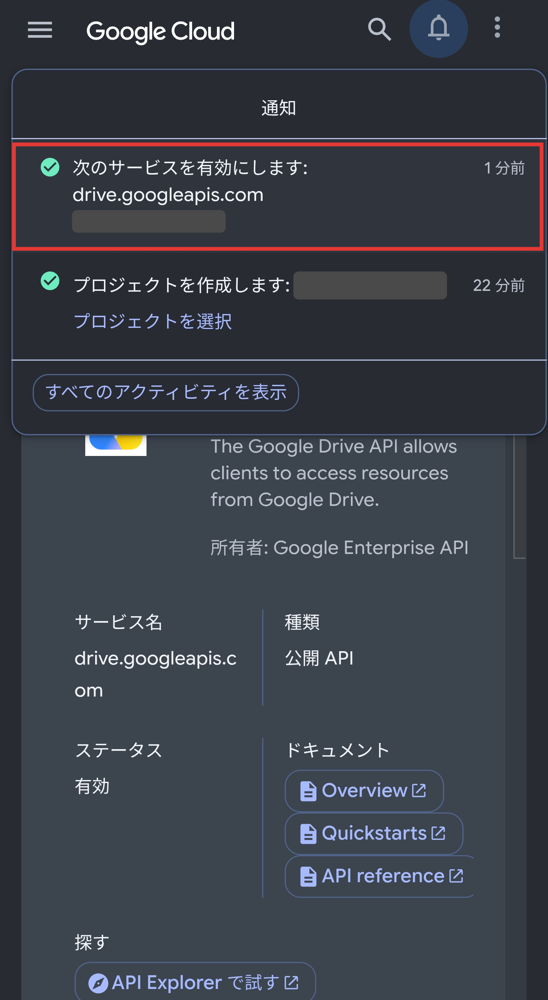

   *▲ 「drive.googleapis.com を有効にします」と出ます*

5. 画面の「ステータス」が「有効」になっていることも確認します（赤い四角）。

   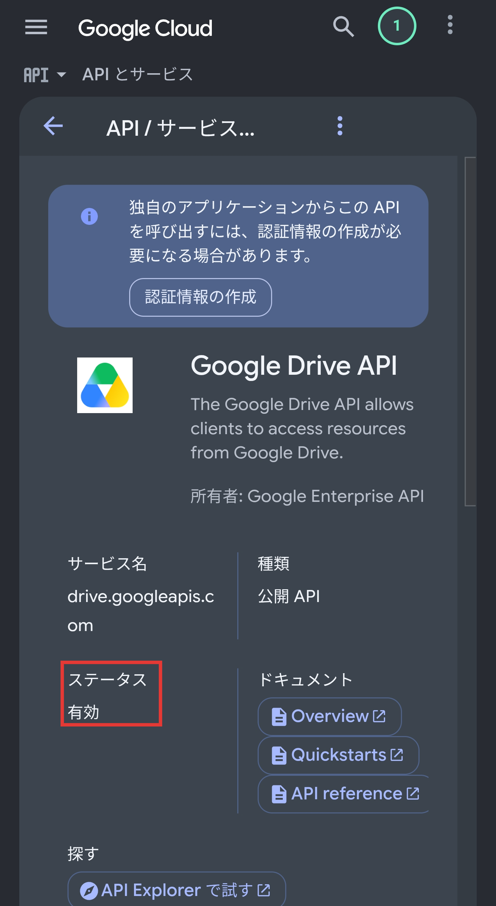

   *▲ 「ステータス」が「有効」になっていれば、できています*

   > この画面で「有効にする」を押しても、お金の画面には行きません。
   > 画面の上のほうに「認証情報の作成」というボタンが出ることがあります。ここではまだ押しません（手順 4 で行います）。

**メニューから行く方法**（リンクが開かないとき）

1. 左のメニューの「API とサービス」→「ライブラリ」を開きます（赤い四角のところ）。

   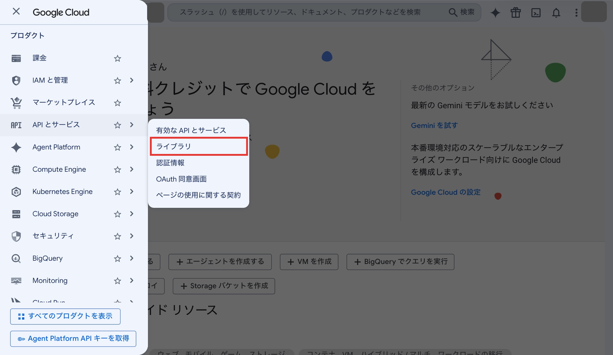

   *▲ 「ライブラリ」を押します*

2. 「ライブラリ」には、とてもたくさんの項目が並んでいます。探さずに、上の検索欄に「Google Drive API」と入れて探してください。
3. 結果の一番上の「Google Drive API」（赤い四角）を押します。「Google Drive MCP」「Google Drive Activity API」「Drive Labels API」ではありません。間違えないでください。

   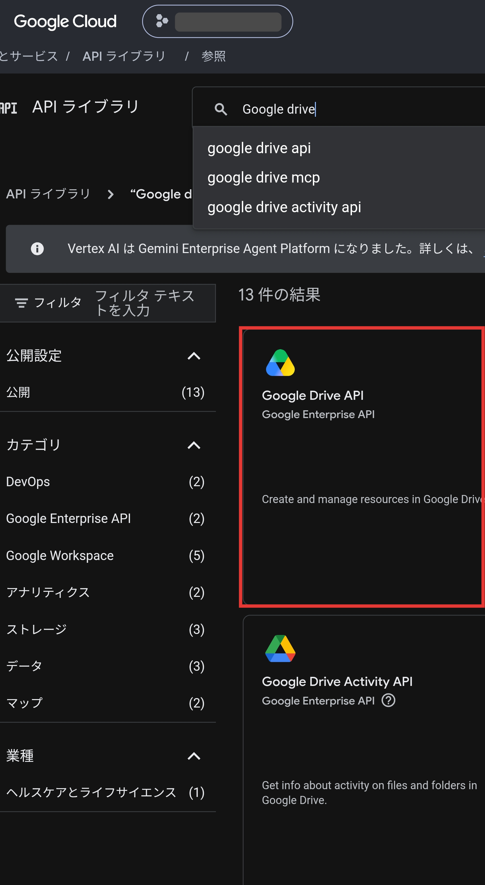

   *▲ 一番上の「Google Drive API」を押します*

   > スマホでは、「ライブラリ」で探すところが狭くてやりにくいです。ここまでは「PC版サイト」にチェックを入れると、やりやすくなります。入れなくても、できないわけではありません。

4. 開いた画面（上の画像と同じ画面）で、「有効にする」を押します。

   スマホの場合：「Google Drive API」の画面（「有効にする」のボタンがある画面）まで来たら、「PC版サイト」のチェックは、はずして大丈夫です。スマホ用の画面でも同じ画面が出ます。「有効にする」（赤い四角）を押します。

   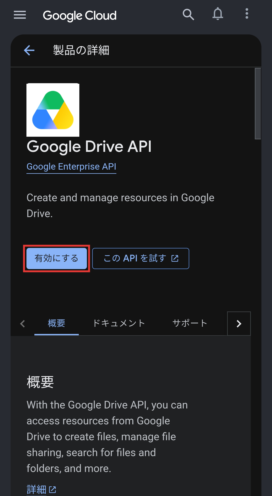

   *▲ 「有効にする」を押します（スマホ）*

> お金の画面（「お支払い」「請求先アカウント」など）が出たら、そこから先には進みません。何も押さずに、https://console.cloud.google.com/ を開き直して、ホーム画面からやり直してください。「請求先アカウントの作成」は押さなくて大丈夫です。Google Drive API をオンにするだけなら、お金はかかりません。

## 3. 同意画面を作る

**かんたんな方法**：次のリンクを押すと、同意画面（Google Auth Platform）が開きます。

👉 [同意画面を開く](https://console.developers.google.com/auth/branding)

先に、上の名前が、手順 1 で作ったプロジェクトになっているか確認してください。

**メニューから行く方法**

1. 「API とサービス」→「OAuth 同意画面」を開きます（赤い四角のところ）。「Google Auth Platform」という名前の画面に変わります。

   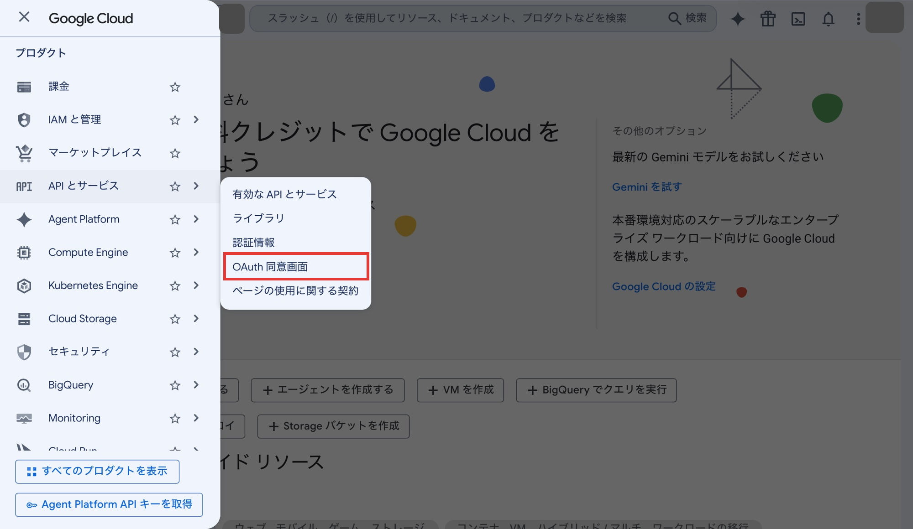

   *▲ 「OAuth 同意画面」を押します*

2. 「Google Auth Platform はまだ構成されていません」と出たら、「開始」（赤い四角）を押します。

   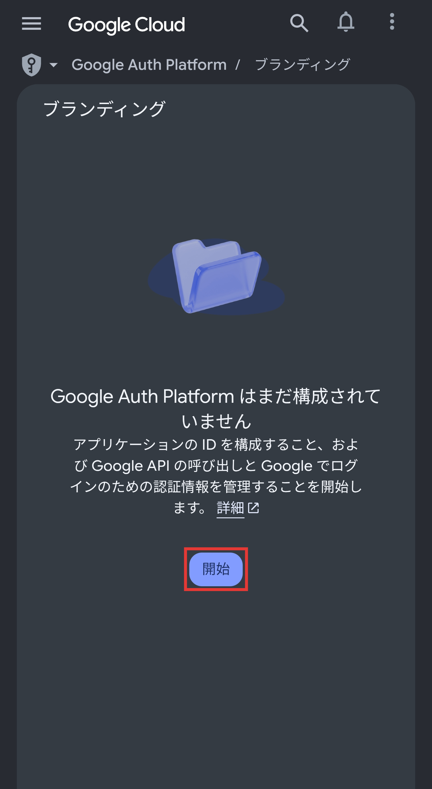

   *▲ 「開始」を押します*

   画面の上に「ブランディング」と書いてありますが、気にしなくて大丈夫です。いま開いている画面の名前です。次の 4 つの画面が順に出ます。

   **(1) アプリ情報**

   - 「アプリ名」（赤い四角）に、好きな名前（例：読書リーダー）を入れます。

     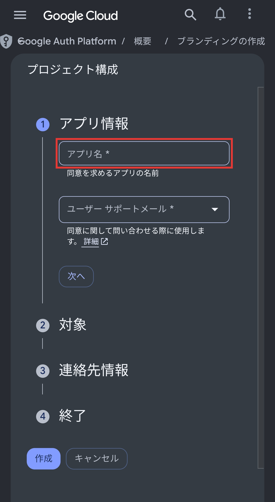

     *▲ 「アプリ名」に、好きな名前を入れます*

   - 「ユーザー サポートメール」（赤い四角）を押すと、自分のメールアドレスが出ます。それを選びます。

     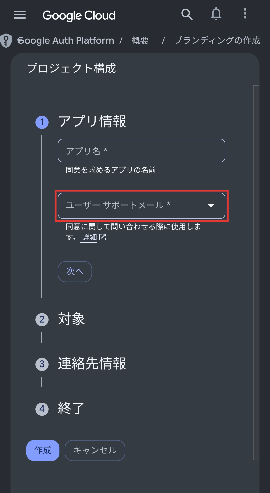

     *▲ 「ユーザー サポートメール」を押して、自分のメールアドレスを選びます*

   - 入れ終わると、こうなります。メールアドレスは隠してあります。

     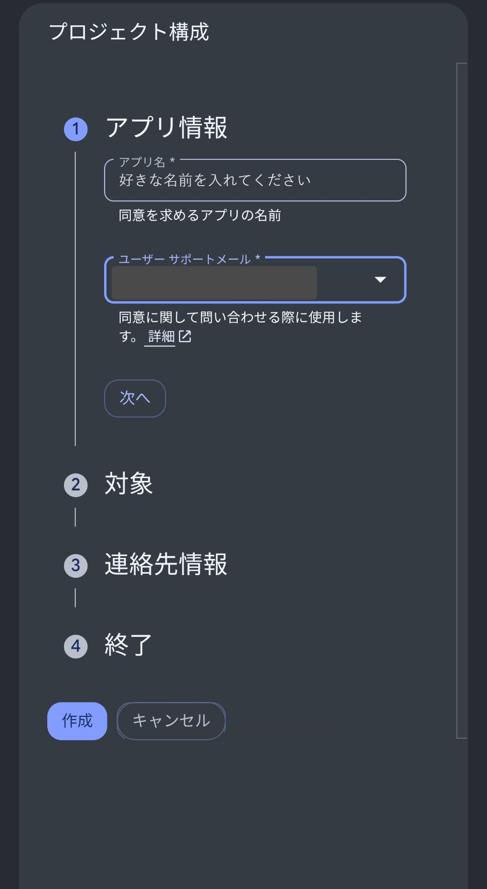

     *▲ 入れ終わると、こうなります*

   - 「次へ」（赤い四角）を押します。

     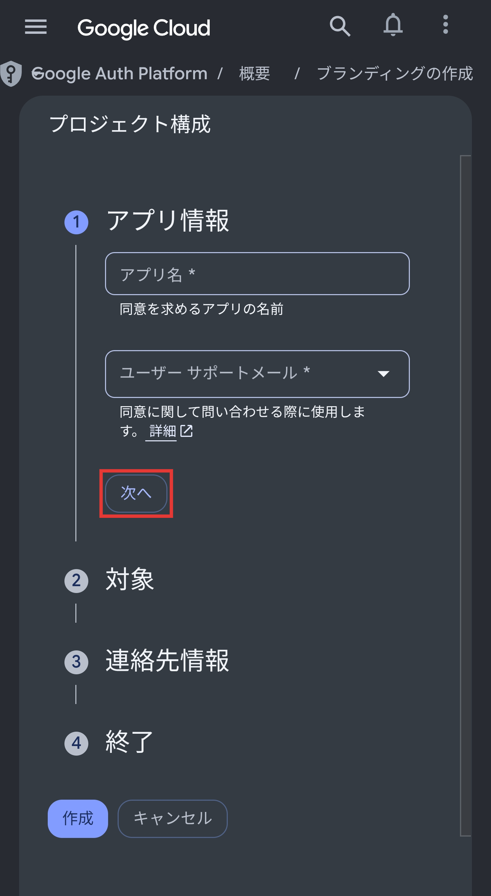

     *▲ 「次へ」を押します*

   **(2) 対象**

   「内部」と「外部」が出ます。「外部」（赤い四角）を選びます。「内部」は、会社などの組織の中だけで使うときの選び方なので、選びません。

   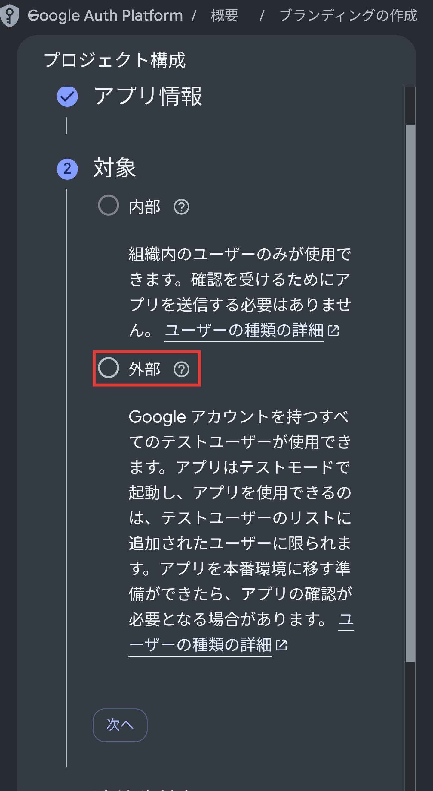

   *▲ 「外部」を押して選びます*

   選んだら、「次へ」（赤い四角）を押します。

   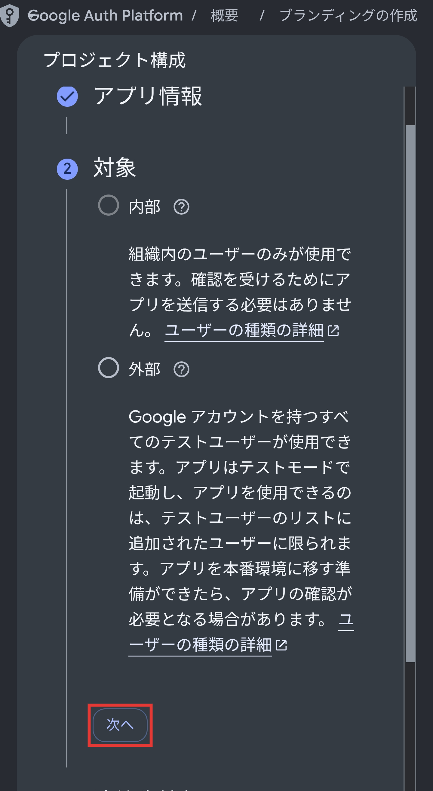

   *▲ 「次へ」を押します*

   **(3) 連絡先情報**

   - 「メールアドレス」（赤い四角）に、自分のメールアドレスを入れます。

     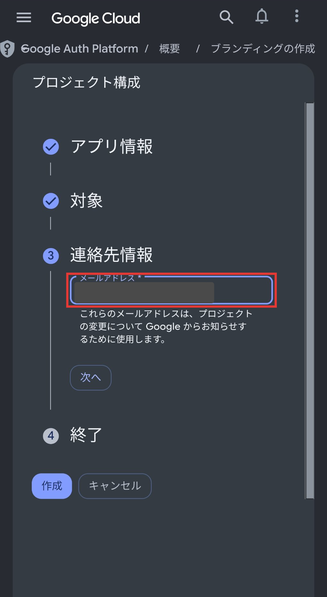

     *▲ 「メールアドレス」に、自分のメールアドレスを入れます*

   - 「次へ」（赤い四角）を押します。

     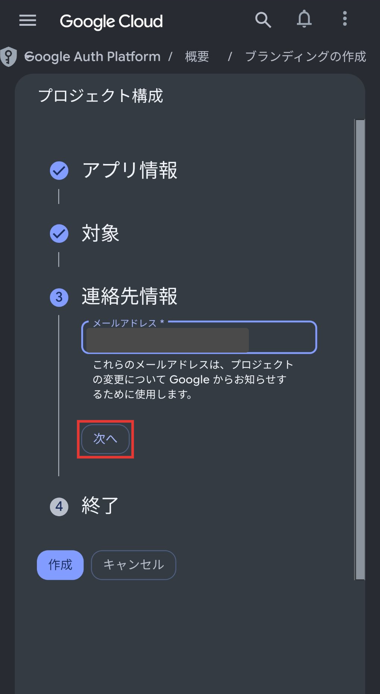

     *▲ 「次へ」を押します*

   **(4) 終了**

   - 「Google API サービス：ユーザーデータに関するポリシーに同意します」の四角にチェックを入れます（赤い四角）。

     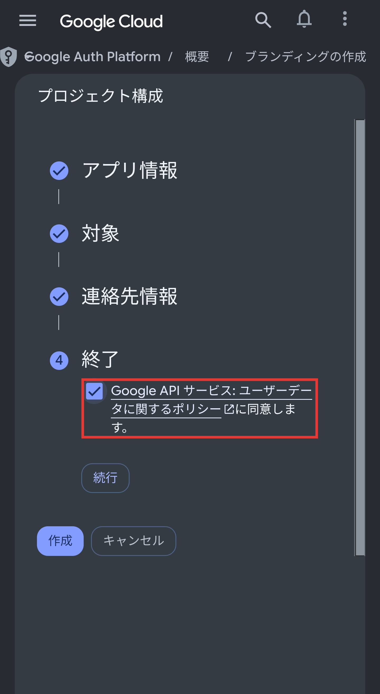

     *▲ 四角を押して、チェックを入れます*

   - 「続行」（赤い四角）を押します。

     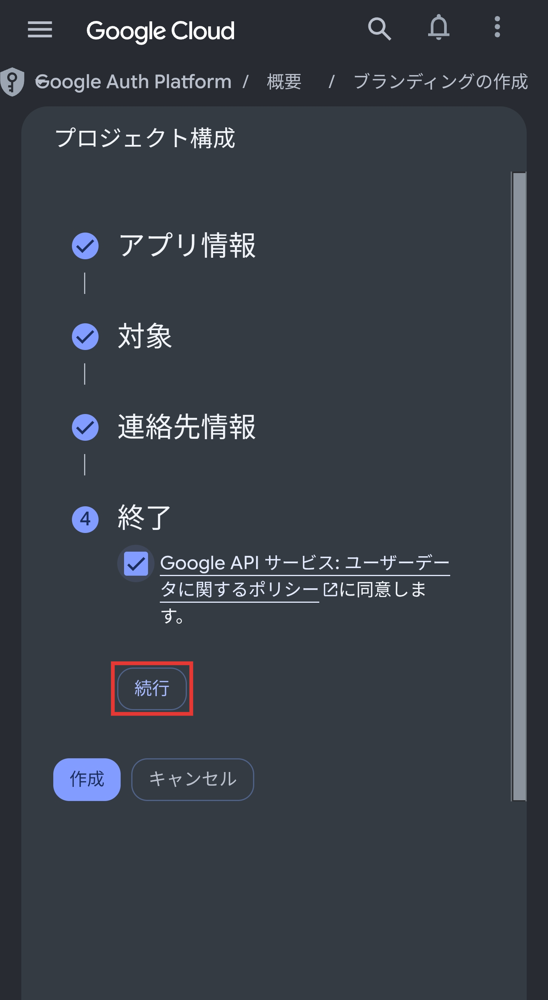

     *▲ 「続行」を押します*

   - 4 つの項目すべてに ✓ がつきます。一番下の「作成」（赤い四角）を押します。

     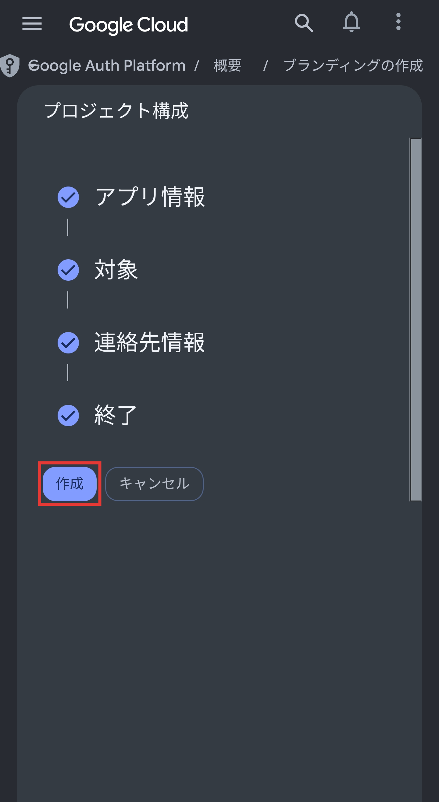

     *▲ 「作成」を押します*

   - 数秒で「OAuth の概要」の画面が開き、下に「OAuth の構成を作成しました。」と出ます（赤い四角）。これで同意画面の設定は完了です。

     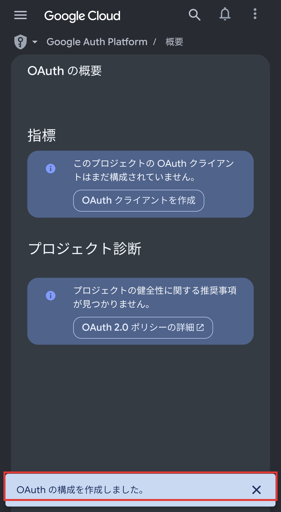

     *▲ 「OAuth の構成を作成しました。」と出れば、できています*

3. 次に、「対象」の画面を開きます。次のリンクを押すと開きます。

   👉 [「対象」の画面を開く](https://console.developers.google.com/auth/audience)

   メニューから行くときは、左の「対象」（英語では Audience）です。「オーディエンス」と書いてあることもあります。

   「公開ステータス」が「テスト中」（赤い四角）になっていることを確認します。「アプリを公開」は押しません。このままで大丈夫です。

   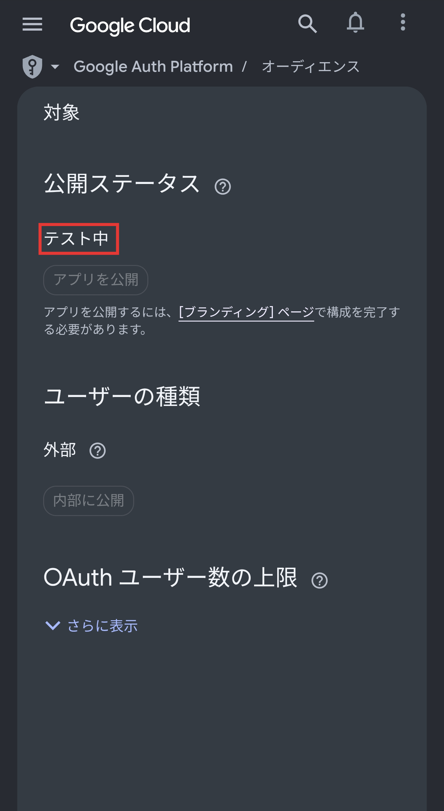

   *▲ 「テスト中」になっています。「アプリを公開」は押しません*

4. 下にスクロールして、「テストユーザー」の「Add users」（赤い四角）を押します。ここは英語のままのことがあります。

   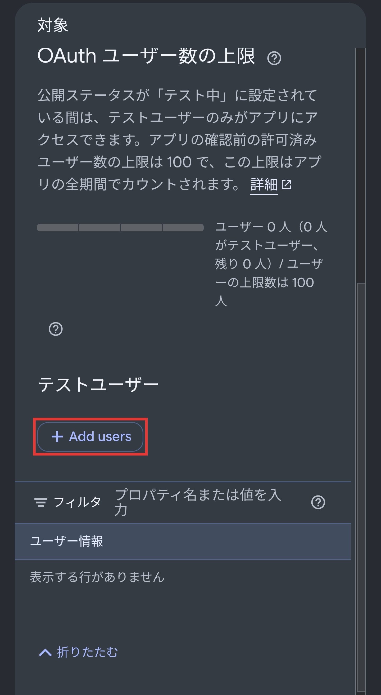

   *▲ 「Add users」を押します*

   「ユーザーを追加」の画面が開きます。

   - 入力欄（赤い四角）に、使う人の Google アカウントのメールアドレスを入れます。自分のメールアドレスも必ず入れてください。複数の人を入れるときは、1 人ずつ入れます（最大 100 人）。

     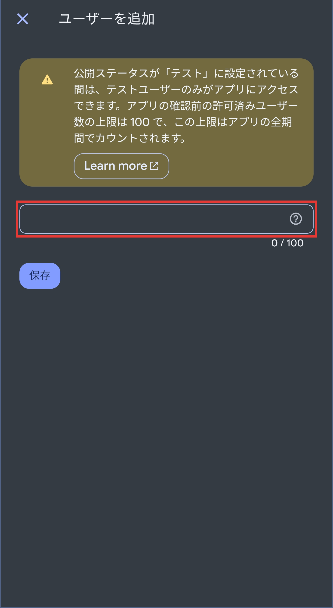

     *▲ ここに、メールアドレスを入れます*

   - 入れたら、「保存」（赤い四角）を押します。ここに入れた人だけが使えます。

     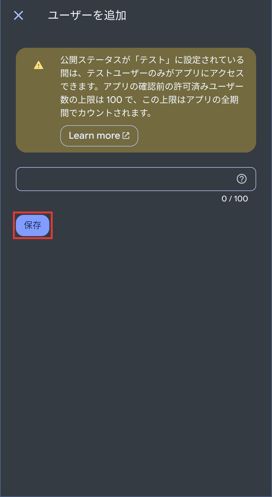

     *▲ 「保存」を押します（2 回押します）*

   - 1 回目の「保存」を押すと、メールアドレスが確定して、入力欄の上の数が「1 / 100」になります。もう一度「保存」を押すと、元の「対象」の画面に戻ります。

   - 「テストユーザー」の一覧にメールアドレスが出て、上のほうに「ユーザー 1 人（1 人がテストユーザー）」と出ていれば成功です（赤い四角）。

     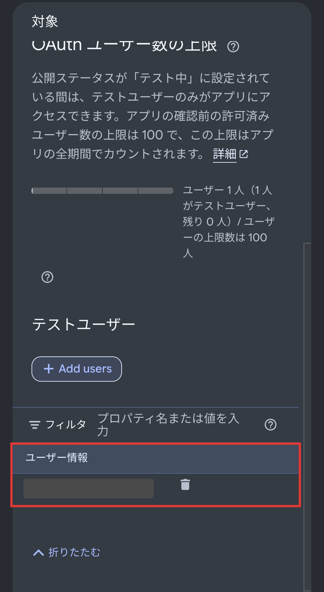

     *▲ 一覧にメールアドレスが出れば、できています*

5. （おすすめ）左の「データへのアクセス」（英語では Data Access）→「スコープを追加または削除」で、「.../auth/drive.file」を選んで「保存」を押します。「このアプリが作ったファイルだけ」を使う、という意味です。

## 4. クライアント ID を作る

まず、「クライアント」の画面を開きます。次の 3 つのどれかで開けます。

- リンクを押す（かんたん）：👉 [クライアントの画面を開く](https://console.developers.google.com/auth/clients)
- 「OAuth の概要」の画面から：手順 3 の最後の画面にある、「OAuth クライアントを作成」のボタン（赤い四角）を押します。

  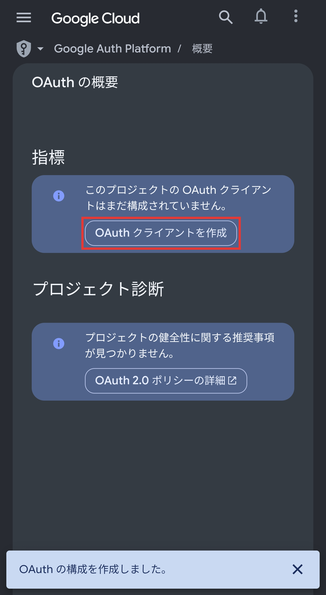

  *▲ 「OAuth クライアントを作成」を押します*

- メニューから：左上の「≡」→「API とサービス」→「認証情報」（赤い四角）を押します。新しい画面では、左のメニューの「クライアント」（英語では Clients）を開きます。

  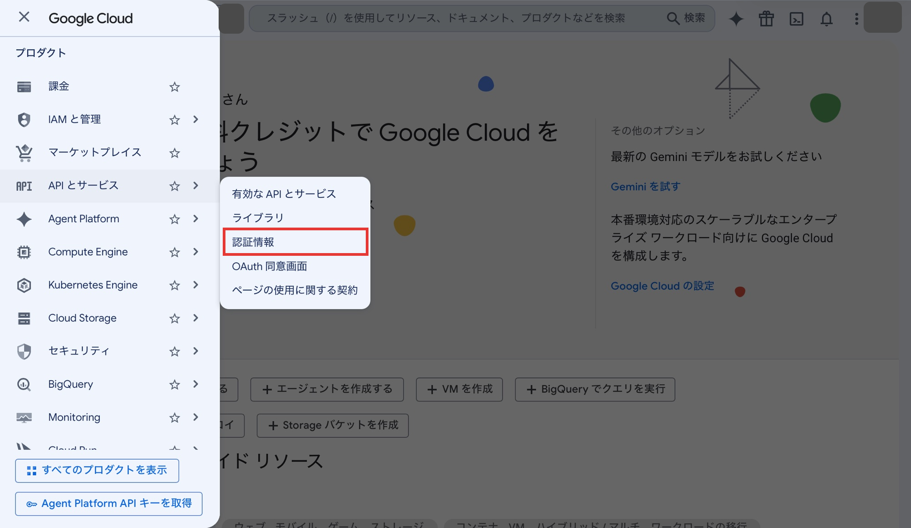

  *▲ 「認証情報」を押します*

次に、クライアントを作ります。

1. 「クライアント」の画面の上にある「⋮」（点が 3 つ。赤い四角）を押します。

   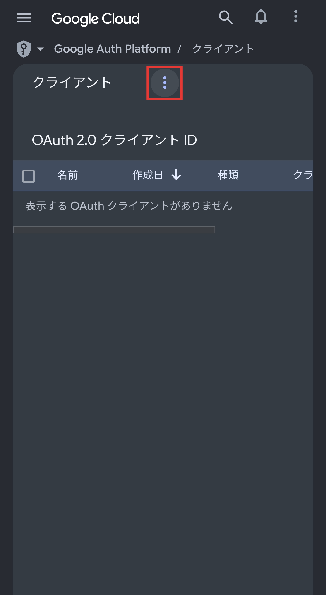

   *▲ 上の「⋮」（点が 3 つ）を押します*

2. 出てきた一覧の「クライアントを作成」（赤い四角）を押します。パソコンでは、画面の上に「クライアントを作成」のボタンが、そのまま出ていることもあります。

   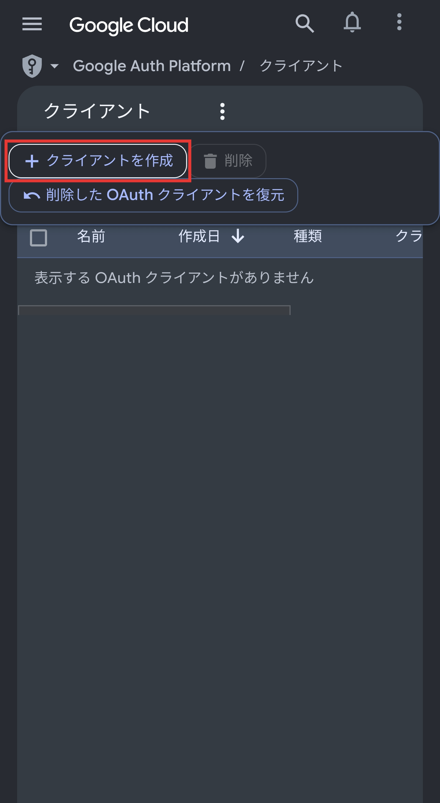

   *▲ 「クライアントを作成」を押します*

3. 「OAuth クライアント ID の作成」の画面が開きます。「アプリケーションの種類」（赤い四角）を押して、一覧から「ウェブ アプリケーション」を選びます。

   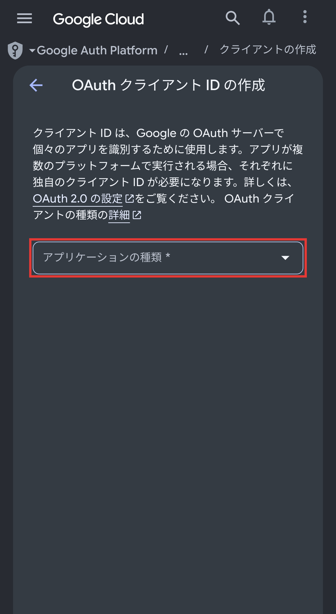

   *▲ 「アプリケーションの種類」を押します*

   一覧が開きます。「ウェブ アプリケーション」「Android」「Chrome 拡張機能」「iOS」などが並んでいます。一番上の「ウェブ アプリケーション」（赤い四角）を押します。

   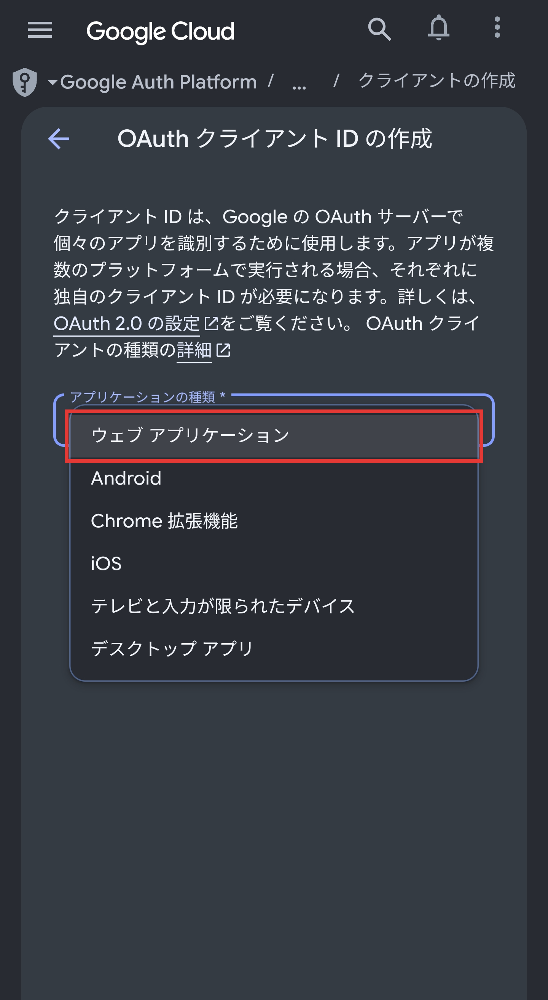

   *▲ 一番上の「ウェブ アプリケーション」を押します*

4. 「名前」には、最初から「ウェブ クライアント 1」と入っています（赤い四角）。そのままで大丈夫です。変えるなら、好きな名前（例：読書リーダー）にします。この名前は自分の画面でだけ使うもので、ほかの人には見えません。

   

   *▲ 名前は、そのままで大丈夫です*

5. 下にスクロールして、「承認済みの JavaScript 生成元」の「URI を追加」（赤い四角）を押します。このアプリのアドレスの、前半だけを入れます。

   

   *▲ 下にスクロールして、「URI を追加」を押します*

   「URI 1」の入力欄（赤い四角）が出ます。ここにアドレスを入れます。

   

   *▲ ここに、アドレスを入れます*

   入れると、こうなります（例：https://example.github.io）。

   

   *▲ 入れ終わると、こうなります（例のアドレスです）*

   入れるのは、次の形です。

       https://to-hu59.github.io

   - 末尾の「/」や「/minimal-editor-dist/」は付けません。
   - パソコンで試すだけの場合は、「http://localhost:8000」も追加します（ポート番号は自分が使うもの）。
   - 「承認済みのリダイレクト URI」は、このアプリでは使いません。空のままにします。
   - 「このクライアントを AI 搭載エージェントに使用する」には、チェックを入れません。

6. 「作成」のボタンは、アドレスを入れるまで灰色で、押せません（赤い四角）。

   

   *▲ アドレスを入れる前は、「作成」は灰色で押せません*

   アドレスを入れると、ボタンが青くなって押せるようになります（赤い四角）。

   

   *▲ アドレスを入れると青くなります。「作成」を押します*

   > 「作成しました」の画面のスクリーンショットは、撮り忘れました。ごめんなさい。

   押すと、クライアント ID が出ます。「1234567890-xxxxxxxx.apps.googleusercontent.com」のような長い文字です。これをコピーします。

   - 「クライアント シークレット」は、このアプリでは使いません。誰にも見せなくて大丈夫です。
   - 作成の画面には、「注：設定が有効になるまで 5 分から数時間かかることがあります」と出ています（赤い四角）。すぐにつながらなくても、あわてず待ってください。

     

     *▲ 「5 分から数時間かかることがあります」と書いてあります。待ちます*

   - 「作成しました」の画面は、少しすると消えることがあります。消えても大丈夫です。クライアント ID は、あとから「クライアント」の一覧で、そのクライアントの名前を押すと見られます。見られなければ、「作成」をもう一度やり直しても構いません。

     「クライアント」の一覧は、スマホでは横に長いので、横にスライドすると、右のほうに「クライアント ID」の列が出ます（赤い四角）。横にコピーのマークがあるので、押すとコピーできます。「✏」（えんぴつ）は、あとでアドレスを変えたり足したりするときに使います。いまは押しません。「ゴミ箱」のマークは、そのクライアントを消すボタンなので、押さないでください。

     

     *▲ 横にスライドすると、「クライアント ID」が出ます。コピーのマークを押して、コピーします*

## 5. アプリに ID を貼る

この手順には、画像がありません。

1. アプリを開きます（https://to-hu59.github.io/minimal-editor-dist/）。
2. 右上の設定（歯車のマーク）を開き、「Google Drive」の欄を探します。
3. 「クライアントID」の欄に、コピーした ID を貼ります。
4. 「IDを保存する」を押します。「IDを保存しました」と出れば完了です。

ID は、使っている端末の中にだけ保存されます。ほかの人には見えません。別の端末で使うときは、その端末でも貼ります。

## 6. つないでみる

1. アプリを開き、本棚の上の「☁」を押します。
2. Google の画面でアカウントを選びます。
3. 「このアプリは Google で確認されていません」と出たら、「詳細」→「（アプリ名）に移動」を押します。自分で作った設定なので、ふつうのことです。
4. 許可する範囲は、「このアプリが作ったファイルだけ」です。ほかのファイルは見えません。
5. つながると、Drive に「読書リーダー(仮)」というフォルダができます。名前は、あとで Drive の中で好きな名前に変えて大丈夫です。

## 自分のアドレスを作りたい人へ

上のアドレスではなく、自分のアドレスで使いたい人は、アプリのコピーを作ります。GitHub Pages を使うと、無料で作れます。GitHub アカウントが必要です。この手順には、画像がありません。

1. [GitHub](https://github.com/) にログインします。アカウントがなければ作ります。
2. [配布版のページ](https://github.com/to-hu59/minimal-editor-dist) を開き、右上の「Fork」を押します。
3. 「Create fork」を押します。自分用のコピーができます。
4. 自分のコピーのページで、「Settings」→ 左のメニューの「Pages」を開きます。
5. 「Branch」を「main」、フォルダを「/ (root)」にして、「Save」を押します。
6. 1〜2 分待って、ページを開き直します。「Your site is live at …」とアドレスが出ます。

アドレスは、次の形です。

    https://自分のユーザー名.github.io/minimal-editor-dist/

このアドレスを開くと、アプリが動きます。

手順 4 の「承認済みの JavaScript 生成元」には、「/minimal-editor-dist/」より前の部分だけを入れます。

    https://自分のユーザー名.github.io

自分のアドレスを作った場合も、クライアント ID は、手順 5 と同じように、アプリの設定の欄に貼れます。コードに入れたい人は、コピーの「index.html」の「const DRIVE_CLIENT_ID_FIXED = '';」の引用符の間に貼って、保存します（「Commit changes」を押します）。

## うまくいかないとき

「400: origin_mismatch」など、アドレスのエラーが出る
→ 手順 4 の「承認済みの JavaScript 生成元」に、いま開いているアドレスが入っていません。末尾に「/」が付いていないか、「http」と「https」を間違えていないか確認してください。

アドレスを入れたのに、「origin_mismatch」が出る
→ 設定が反映されるまで、5 分から数時間かかることがあります。5 分ほど待ってから、もう一度試してください。

「アクセスをブロック: このアプリは確認プロセスを…」と出る
→ 手順 3 の「テストユーザー」に、そのメールアドレスが入っていません。

「☁」を押しても何も起きない
→ 手順 5 で、設定の欄にクライアント ID を貼っていないか、貼り間違えています。

数日たつとつながらなくなる
→ 「テスト中」のままだと、Google の都合で許可が切れることがあります。もう一度「☁」を押して、許可し直してください。

## Google の公式の説明（日本語）

- プロジェクトを作る：https://developers.google.com/workspace/guides/create-project?hl=ja
- API をオンにする：https://developers.google.com/workspace/guides/enable-apis?hl=ja
- 同意画面を設定する：https://developers.google.com/workspace/guides/configure-oauth-consent?hl=ja
- クライアント ID を作る：https://developers.google.com/workspace/guides/create-credentials?hl=ja

## 気をつけること

- ログイン（Google の許可）は、約 1 時間で切れます。設定の Google Drive の欄に、「ログインが切れたら、さわったときに自動でやり直す」があります（はじめはオン）。オンなら、切れたあとに画面をさわると、小さな窓が一瞬ひらいて、つなぎ直します。
- クライアント ID は、人に見られても問題ありません。ただし自分のプロジェクトのものです。ほかの人にも使わせたい場合は、その人にそれぞれ作ってもらうほうが安全です。
- 作品の本文は、Drive にも置かれます。どの Google アカウントでつなぐか、気をつけてください。
