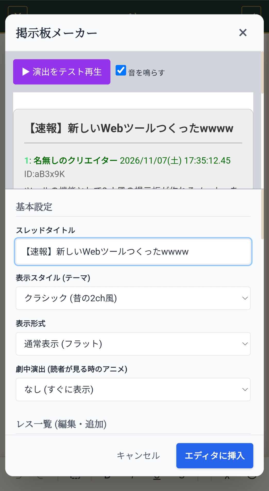
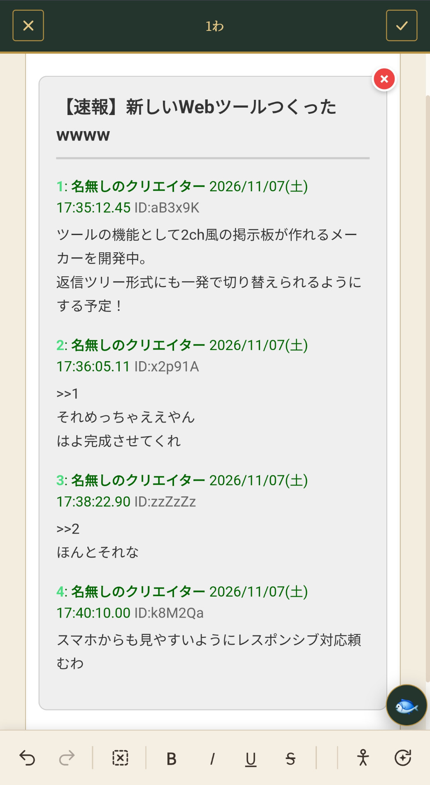
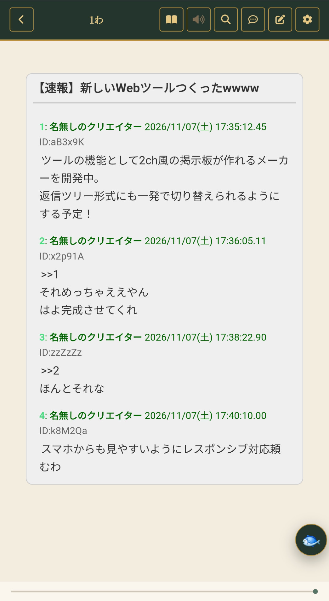

# 特殊演出の書き方

> この文書は AI が書きました。作者が思いつきで機能を足すので、増えたら、このページに追記していきます。追記した項目には、日付（例：2026.11.4 追加）を書きます。ここに書いていない演出も、あるかもしれません。

最終更新：2026.11.7

本文の中に「印」を書くと、画面の枠や、文字の動きが付きます。印は、すべて全角のカッコ「［ ］」で書きます。

編集画面の右にある、次のボタンから入れると、印を自分で打たなくて済みます。

- 回転の矢印と星のマーク「特殊演出」：枠・音・振動・システム画面・掲示板・流れる文字・ホラーなど
- 人のマーク「特殊な文字」：縦書き・ななめ・反転・回転

## 印の使い方（共通）

### 次の 1 行にかける
印だけの行を書くと、すぐ下の行に効きます。印の行は、画面には出ません。

    ［着信］
    電話が鳴った。

### 一部の文字だけにかける
「［名前］」と「［／名前］」で、挟みます。

    ［怒鳴り］ふざけるな！［／怒鳴り］と彼は言った。

### 枠で囲む
始まりの印と、終わりの印（「［／…］」）で、囲みます。

    ［窓 色=青 形=ファンタジー］
    ここに書いたものが、枠の中に入る。
    ［／窓］

## 1. 文字の向き（2026.11.3）

止まった見た目で、文字の向きを変えます。

- ［縦書き］：縦に並びます。一部だけにも使えます
- ［ななめ］：1 文字ずつ、右にずれて、下に並びます
- ［ななめ左］：1 文字ずつ、左にずれて、下に並びます
- ［左右反転］：鏡のように、左右が逆になります
- ［上下反転］：上下が逆になります
- ［回転］：右に 90 度まわります（縦に読みます）
- ［回転 角度=45］：角度を数字で指定します（この書き方の行は、編集画面では、印のまま見えます）
- ［逆さ］：上下左右とも、さかさまになります

一部だけにかけるときは、「［名前］」と「［／名前］」で挟みます。例です。

    ［縦書き］こんにちは［／縦書き］、彼は私にそう言った。

編集画面では、ルビや文字色と同じように、その場で見た目が変わります（2026.11.3 追加）。文字を選んでから「特殊な文字」のボタンを押すと、その文字だけにかかります。何も選ばずに押すと、いまの行ぜんぶにかかります。「ななめ」は、まとまりとして見えるので、消すときは、まるごと消します。

## 2. 音・振動（2026.11.3）

「音を出す」「振動する」を、設定でオンにしたときだけ、音と振動が出ます。

- ［着信］：電話の着信のように、ゆれて、音が鳴ります
- ［バイブ］：ぶるぶるとゆれて、振動します
- ［着信 バイブ］：着信の音と、振動が、同時に出ます
- ［怒鳴り］：強くゆれて、振動します。一部の文字だけにも使えます
- ［ジジッ］：文字がブレます（ノイズ）
- ［頭痛］：文字がぼやけて、重く響きます
- ［どくん］：鼓動のように脈打ちます（心臓の音と振動）

## 3. システム画面（2026.11.3）

青・茶・赤・黒の枠です。「形」で、枠の形を選びます。

    ［窓 色=青 形=ファンタジー］
    ステータスやスキルの一覧など。
    ［／窓］

- 青（ステータス・スキル一覧など）：［窓 色=青 形=ファンタジー］
- 茶・黄土色（回帰者の画面など）：［窓 色=茶 形=ファンタジー］
- 赤（エラー・警告・乗っ取りなど）：［窓 色=赤 形=近未来］
- 黒（不気味なシステム・端末）：［窓 色=黒 形=端末］

終わりは、すべて「［／窓］」です。

## 4. ゲームの画面（2026.11.3）

### クエスト
金色の枠です。

    ［窓 色=金 名=クエスト］
    題：
    内容：
    報酬：
    期限：
    ［／窓］

### アイテム購入
緑の枠です。

    ［窓 色=緑 名=アイテム購入］
    商品：
    値段：
    残高：
    ［購入する］　［やめる］
    ［／窓］

### ステータス
名前・レベル・HP などを、行で書きます。

    ［ステータス］
    名前：
    レベル：
    ［／ステータス］

## 5. チャット・通知（2026.11.3）

### 通知（上から降りてくる）

    ［LINE通知 アプリ=カカオ 秒=3.5］
    相手：本文
    ［／LINE通知］

カカオトークは「アプリ=カカオ」、LINE は「アプリ=LINE」です。「秒」は、表示される長さです。

### 会話画面（吹き出し）

    ［トーク 見た目=カカオ 相手=相手の名前］
    相手：こんにちは
    自分：こんにちは
    ［／トーク］

LINE は「見た目=LINE」です。

### ゲームへの招待
カカオトークの通知から会話になり、「はい」「いいえ」が出ます。🎬「演出」ビューで動きます。

    ［招待状 見た目=カカオ 問い=ゲームに参加しますか？］
    ［／招待状］

## 6. 1 行の通知（2026.11.3）

「〜を獲得しました」のような、1 行のシステムの声です。

- 通知：［システム 文=ここに文］
- 警告（赤）：［システム 種類=警告 文=ここに文］
- アイテム入手：［システム 種類=アイテム 文=ここに文］
- スキル獲得：［システム 種類=スキル 文=ここに文］

## 7. 掲示板（2026.11.7 更新）

編集画面の「特殊演出」から掲示板を選ぶと、「掲示板メーカー」が開きます。印を手で書かずに、見た目を確認しながら作れます。

### メーカーで作る・直す

1. 「基本設定」で、スレッドタイトル・表示スタイル（テーマ）・表示形式・劇中演出（読者が見る時のアニメ）を選びます。
2. 「レス一覧（編集・追加）」で、投稿ごとの名前・ID・本文・返信先を入力します。「日時」を開くと、日時も直せます。本文の途中で改行しても、同じ投稿のままです。
3. 「＋ 新しいレスを追加」で投稿を増やします。要らない投稿は、その投稿の「削除」で消せます。
4. プレビューを確認して、「エディタに挿入」を押します。すでにある掲示板は、本文の編集画面で「この掲示板を編集」を押して開き、直したら「変更を反映」を押します。

右上の「×」または「キャンセル」で、変更を反映せずに閉じます。本文に挿入したあとは、作品の編集画面で保存してください。

### 表示スタイルは 8 種類

- クラシック（昔の2ch風）
- ダーク（5chダーク風）
- モダン（スマホチャット風）
- かわいいピンク
- ファンタジー（羊皮紙風）
- ターミナル（ハッカー風）
- サイバーパンク（ネオン風）
- アングラ（毒々しい裏掲示板風）

### 表示形式は 3 種類

- 通常表示（フラット）：番号順に並びます。
- 返信ツリー方式（階層）：返信先の投稿の下に、字下げして並びます。
- チャット方式（左右吹き出し）：通常の投稿と返信を、左右の吹き出しで表示します。

返信は、投稿ごとの「返信先」で選べます。表示形式を変えても、投稿の内容や返信先は残ります。

### 番号なし・色の変更

「追加設定：色・番号・板の名前」を開きます。

- 「番号・名前の表示」で「番号なし」にすると、番号や名前などを出さずに本文を表示します。隠した情報は残るので、「番号・名前あり」に戻せます。
- 背景色・本文色・名前色・枠色を選べます。「色をテーマの標準に戻す」で、選んだテーマの色に戻せます。
- 板の名前も入力できます。空欄でも使えます。

### 本文の上で直接直す

本文の編集画面では、挿入した掲示板のタイトル・名前・本文などを、見た目のまま直接直せます。文字を選んで、通常の編集道具から太字・文字色・ルビなども付けられます。投稿の追加や返信先・テーマなどを変えるときは、「この掲示板を編集」を使います。

「（写真）」は、そのまま文字として入力できます。画像には置き換わりません。

画面内の書き込みは、操作例のサンプルです。「開発中」「予定」などは、現在の機能の状態を示す説明では、ありません。

### 演出とページめくり

劇中演出は「なし（すぐに表示）」「ポンポン表示（フェードイン）」「カタカタ入力（タイピング音付き）」から選べます。メーカーの「▶ 演出をテスト再生」で確認できます。テストの音は、その隣の「音を鳴らす」で、切り替えます。

読む画面では、ほかの演出と同じ上部の再生ボタンで、本文の中でもう一度動かせます。途中で掲示板をタップすると、最後まで表示します。

ページめくりでは、1 ページに収まる掲示板は途中で切らず、必要なら枠ごと次のページへ送ります。1 ページより長い掲示板は、これまでと同じように複数のページに分かれます。

### 前の書き方も使えます

すでにある掲示板の印は、そのまま読めます。次のような手書きの掲示板も使えます。

    ［掲示板 形式=2ch 見た目=定番 板=板の名前 題=スレのタイトル］
    1 名無しさん：書き込み
    2 名無しさん：>>1 返信
    ［／掲示板］

この旧形式の「形式=2ch／ツリー」「見た目=定番／ふつう／明るい／裏」も残っています。新しい 8 種類のテーマやチャット表示を使うときは、メーカーで選んでください。

## 8. 流れる文字・案内板（2026.11.3 追加）

演出ビュー（🎬）で動きます。

### 電光掲示板（右から左へ流れる）
光る点の文字が、右から左へ流れます。文の 1 行が、1 つの流れになります。

    ［電光掲示板 背景=黒 文字=橙 速さ=ふつう］
    ［赤］注意［／赤］　まもなく電車が参ります
    ［緑］二行目の文［／緑］［改行］さらに次の行
    ［／電光掲示板］

- 背景：掲示板の背景の色。色の名前か、「#ff0000」のような色の番号
- 文字：文字の、ふだんの色（はじめは橙）
- 速さ：おそい・ふつう・はやい（数字でも指定できます）
- 文字ごとの色：［赤］…［／赤］。使える色は、赤・橙・黄・緑・青・水色・紫・桃・白・黒・灰。「［色=#ff0000］…［／色］」でも指定できます
- 文字ごとの背景の色：［地=黄］…［／地］
- 次の行に移る：［改行］
- 色の指定を何も書かないと、前からある、橙色の 1 行の掲示板になります

### 電光掲示板（折り返して止まる）
「折り返し」を付けると、長い文を、幅に合わせて何行かに分けます。流れ続けず、右から入ってきて、止まります。

    ［電光掲示板 背景=紺 折り返し 速さ=はやい］
    ［緑］お知らせです。［／緑］長い文は、自動で折り返されます。
    ［／電光掲示板］

### 駅の発車案内
1 行ずつ「時刻 行き先 番線 状況」と書きます。パタパタと文字がめくれます。

    ［案内板 駅 流れる=まもなく、2番線に快速がまいります。 変わる=2:遅延］
    18:42 快速東京 2番 定刻
    18:50 各停高尾 1番 定刻
    ［／案内板］

- 流れる：下に流れる案内の文
- 変わる：「行の番号:言葉」。しばらくして、その行の状況が、その言葉に変わります

### 空港の出発案内
1 行ずつ「時刻 行き先 ゲート 状況」と書きます。

    ［案内板 空港 題=出発／DEPARTURES 変わる=3:欠航］
    20:10 札幌 12 搭乗中
    20:25 福岡 08 定刻
    20:40 那覇 15 定刻
    ［／案内板］

## 9. ホラー・ぐちゃぐちゃ（2026.11.3 追加）

演出ビュー（🎬）で動きます。

### 文字化けするシステム画面
画面の文字が、ジジッとずれて、記号まじりに化けます。最後の「元に戻る」で、読める文に戻ります。

    ［システム画面 色=青 形=近未来］
    好感度：75%
    ［エラー 1 ジジッ グリッチ ノイズ］
    好感度：███%
    ［エラー 2 赤 文字化け］
    ［警告！］
    ［エラー 終わり 元に戻る］
    ［／システム画面］

- ［エラー 1］［エラー 2］…：段階の行。そこから先の行が、乱れます
- 段階で使う言葉：グリッチ・ノイズ・文字化け・暴走・赤・黒・乗っ取り・解放・ジジッ・ザザッ
- ［エラー 終わり 元に戻る］：乱れを止めます（「黒のまま」「強制終了」も使えます）

### 文字が崩れる配信コメント
コメントがおかしくなり、文字がぐちゃぐちゃに崩れて、画面を埋め尽くします。

    ［流れるコメント 題=廃病院から生配信 同接=1,284 時間=1:02:44 背景=なし］
    ゆう：こんばんは
    ［おかしく 1 同接が化ける 変な人］
    404：……
    ［おかしく 2 ノイズ 時間が戻る 文字が踊る］
    k：ねえ
    ［おかしく 3 埋め尽くす 文字が崩れる 切り抜き］
    ゆう：にげて
    ［おかしく 終わり 全部消える］
    ［／流れるコメント］

- ［おかしく 数字 …］：段階の行。段階が進むほど、おかしくなります
- 段階で使う言葉：同接が化ける・時間が戻る・ノイズ・変な人・文字が踊る・文字が崩れる・埋め尽くす・全部消える・切り抜き
- 「言葉=つぎはあなた」のように書くと、崩れた文字が集まって、その言葉になります

### ページがめくれない
ページをめくろうとしても、めくれません。「回数」の分だけ逆らってから、進みます。

    ［めくれない 回数=6 文=めくらないで］

### ページが巻き戻る
指定したページまで、ページが巻き戻ります。数字は、戻る先のページです。

    ［巻き戻し 1］

## 追記のメモ

新しい演出を足したときは、番号つきの項目として追記し、見出しに「（2026.11.4 追加）」のように日付を書きます。上の「最終更新」の日付も、直します。

## 更新の記録

- 2026.11.7：掲示板の画面写真を追加し、現在の操作に合わせて説明を更新しました。

- 2026.11.3：配布版から、演出カタログ（🎬の「見本から選ぶ」画面と、演出をつくる画面）を外しました
- 2026.11.3：編集画面で、文字の向きが、その場で見えるようにしました
- 2026.11.3：文字の向き・音・振動・システム画面・ゲームの画面・チャット・通知・1行の通知・掲示板・流れる文字・案内板・ホラーを書きました
