# 読書リーダー(仮) はじめの手引き

> この文書は AI が書きました。画面の名前や場所は、アプリの更新で変わることがあります。写真の赤い枠の数字は、文章の数字と、同じ場所です。

まずは、これだけ読めば、使えます。Google Drive の設定は、要りません。

## 1. 開く

- ブラウザで、アプリのアドレスを開きます。
- スマホは、ブラウザのメニューから「ホーム画面に追加」を選ぶと、アプリのように使えます。
- **パソコン（Chrome・Edge）**でも、アプリとして追加できます。アドレス欄の右の「インストール」のマーク（またはメニューの「アプリのインストール」）を押すと、「アプリのインストール」の窓が出ます（写真）。案内に従って、進むと、ナビゲーションバー（タスクバー）などに、アイコンが追加されます。
- ブラウザの**ブックマーク**に追加するのも、もちろん、できます。

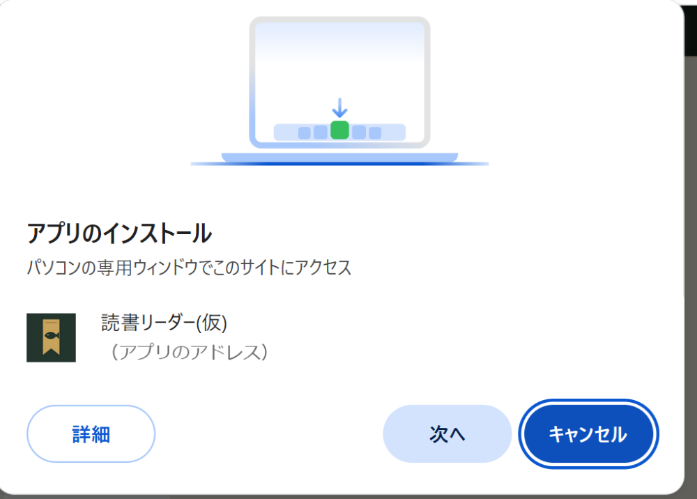

## 2. 本棚と、作品の登録

- 本棚の写真（左）の、番号の意味です。
  - ①「＋」：新しい作品を登録します。
  - ②「田」のマーク：本棚の見た目を、「リスト」と「表紙を並べる」（写真の右）で、切り替えます。
  - ③魚のボタン：検索などが開けます。
  - ④歯車：全体設定です（バックアップは、ここにあります）。

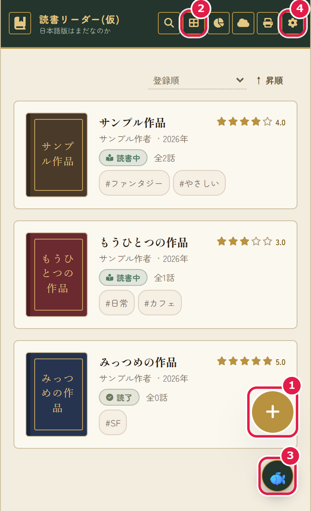

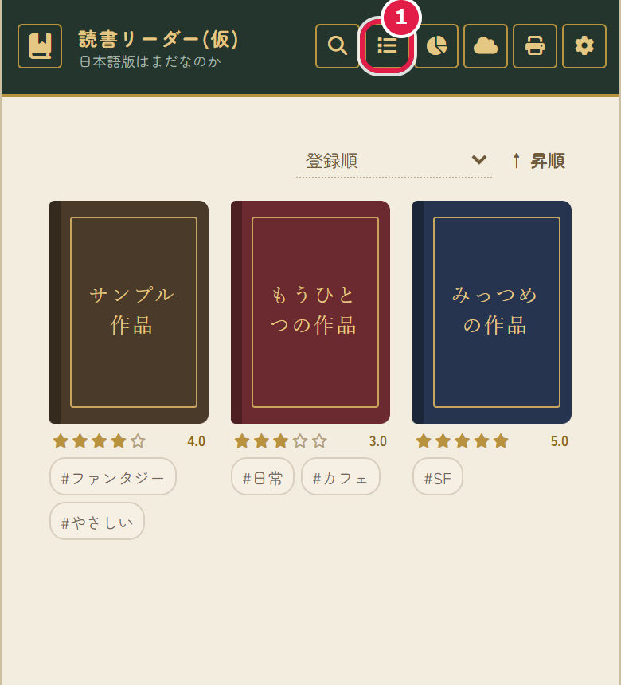

- 「＋」を押すと、「新しい作品の登録」が開きます。
  - ①**作品タイトル**だけが、必須です（赤い星）。作者名・レーベル・原題は、なければ、空で大丈夫です。
  - 分類：タグかジャンル（1つ）を付けます。「新しい分類」に書いて「追加」するか、下に並ぶ、いままでの分類を押して、選びます（もう一度押すと、外れます）。
  - ②**作品のタイプ**：話の並べ方を選びます。迷ったら、「A 単話のみ」で大丈夫です。
    - A 単話のみ：話を順に並べます。
    - B ebookのみ：「巻」に分けて、巻の中に話を並べます。
    - C 単話＋ebook：「単話」と「ebook」の2つを、タブで切り替えます。
    - D 部ごとに単話／ebook：作品を「部」に分けて、部ごとに、単話かebookかを選びます。
  - ③**ファイルから作る**：Word・テキスト・MD・HTML・バックアップのJSONから、そのまま作れます。
  - ④**登録する**を押すと、できあがります。

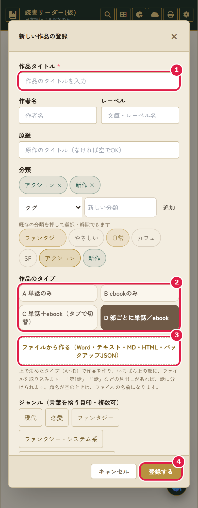

## 3. 話を足す

作品を開いて、「収録内容」の「＋ 追加」（写真の①）を押すと、「追加」の窓が開きます。

- ①**話を追加**：1話ずつ、題名と本文を入れます。
- ②**話をまとめて作る（箱だけ）**：「1話」〜「10話」のように、空の話を、先にまとめて作ります。あとから、ファイルで、中身と題名だけを入れられます。
- ③**貼り付けて追加**：コピーした本文を、貼り付けて、話にします。
- ④**ファイルから**：Word・テキスト・MD・HTMLを選びます。見つかった話の一覧から、入れたい話を選べます。空の話があれば、番号で合わせて、題名と中身を入れます。

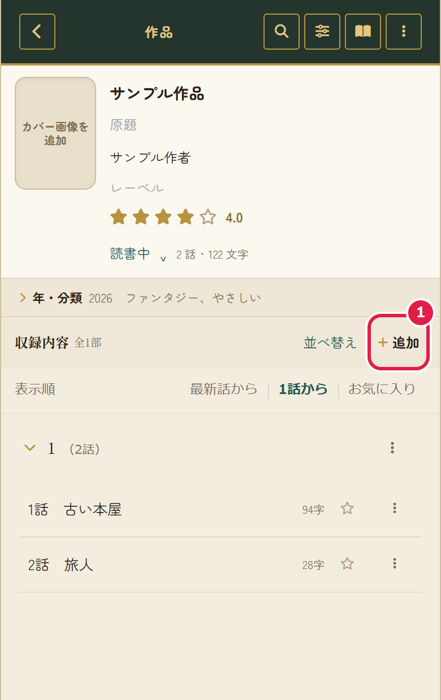

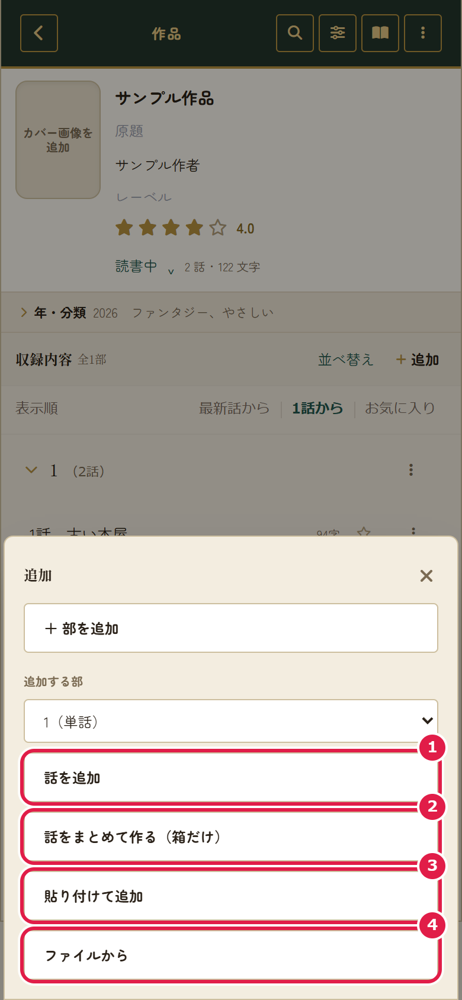

## 4. サンプル作品を消す（長押しで削除）

- 最初に、サンプルの作品が入っています。必要なかったら、消してください。
- 消したい作品を、**長押し**すると、選ぶ状態になります。選んだ作品には、**☑**が付きます。ほかの作品も押すと、まとめて選べます。もう一度押すと、☑が**外れて**、選ばない状態に戻ります。**削除したい作品に、☑を付けてから**、「削除」を押します。
  - ①「×」：選ぶのをやめます。
  - ②「すべて選択」：全部の作品を選びます。
  - ③「隠す」：消さずに、本棚から見えなくします。
  - ④「削除」：選んだ作品を、消します。

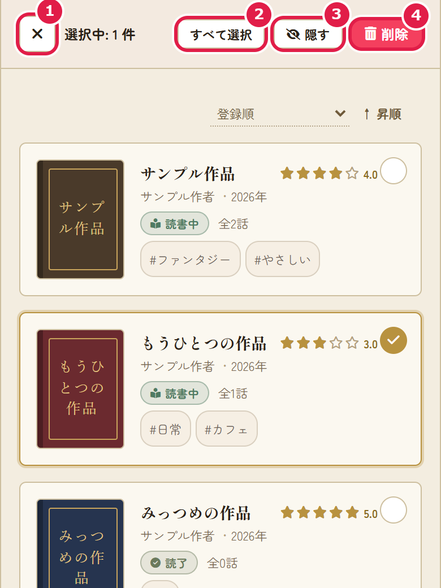

## 5. 読む

- 作品を開いて、話を押します。続きは、次に開いたとき、前に読んだところから読めます。
- ①歯車：読む画面の設定を開きます（次の項目）。②えんぴつ：本文を直します。③魚：検索などが開けます。

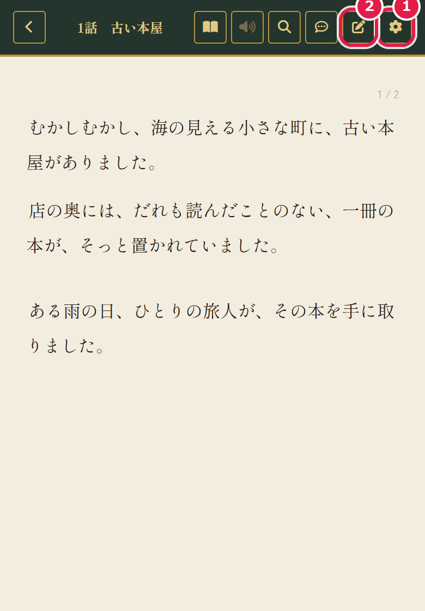

## 6. 読む画面の細かい設定

読む画面の右上の歯車（前の項目の①）を押すと、「読書環境の手帖」が開きます。

- ①**文字サイズ・行の間隔**：「−」「＋」で変えます。
- ②**読み方**：「縦スクロール」と「ページめくり」を選べます（写真の右）。ページをめくる動き、話のあいだに次の話の題名を出すか、パソコンでの見開きも、ここで入れたり切ったりします。
- ③**紙の風合い・テーマ**：「生成り」「白紙」「夜間灯」から選びます。
- ④**書体（フォント）**：端末に入っている明朝体とゴシック体から選びます。自分のフォントを足すこともできます（使ってよいフォントか、配布元の規約を確かめてください）。
- ⑤**アシスタント（魚）**：魚のボタンについての設定です。
- ⑥**音声朗読設定**：読み上げの声、音声エンジン、次の話の自動再生、作品名や話の題名を読むか、などを決めます。

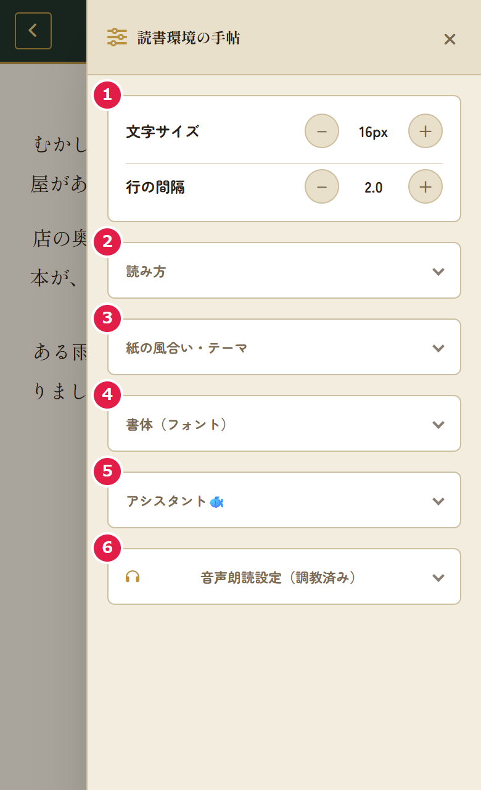

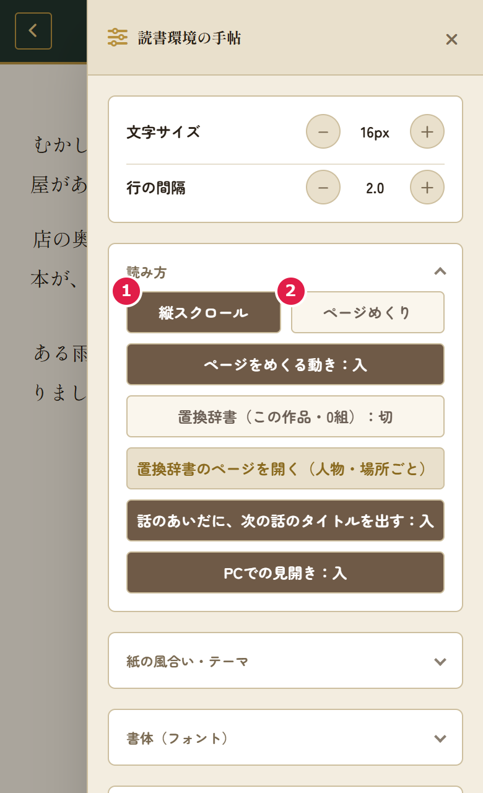

## 7. バックアップ（大事です）

- 作品は、使っている端末のブラウザの中に保存されます。ブラウザの保存データを消すと、作品も消えます。
- 本棚の上の歯車（全体設定）を開きます。
  - ①**作品・Wiki・設定をJSONで書き出し保存**：全部を、1つのファイルにします。ときどき、押して、ファイルを保管してください。
  - ②**選んだ作品だけ書き出す**：作品を選んで、書き出します。
  - ③**バックアップの一覧（フォルダ）**：パソコンの Chrome・Edge で、バックアップを置いたフォルダの中の一覧から、選べます。
  - ④**JSONファイルから読み込み**：バックアップのファイルを選びます。今の作品は、消えません。
- Google Drive との同期は、おまけです。むずかしければ、しなくて大丈夫です。

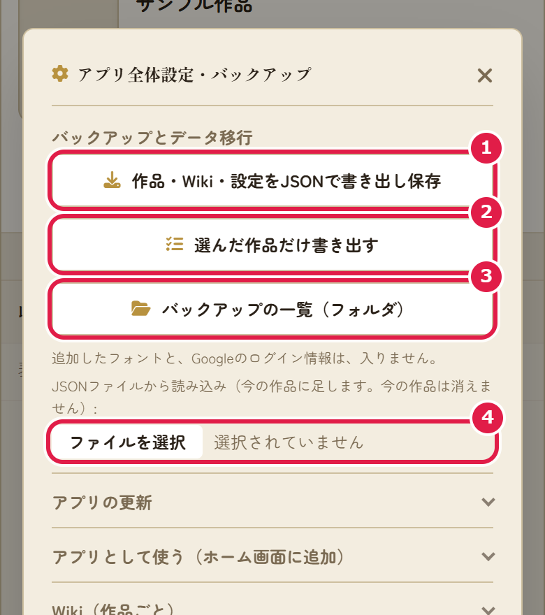

## 8. 困ったとき

- 古い画面が出るとき：魚のボタンの「最新版にする」、または、全体設定の「アプリの更新」の「最新版にする」を押します。
- わからないことがあれば、作者に聞いてください。

## もっと知りたいとき

- 画面で見る使い方（応用）：`docs/app.pdf` / `docs/app.docx`（編集・ここだけ編集・特殊な文字・特殊演出・音読・読書ノート・作品の詳細設定・タグとジャンル・Wiki・置換辞書）
- 使い方（くわしい）：`docs/usage.docx`
- 特殊演出の書き方：`docs/effects.docx`
- Google Drive の設定（必要な人だけ）：`docs/drive-setup-easy.docx`（かんたん版）、`docs/drive-setup-detail.docx`（くわしい版）
