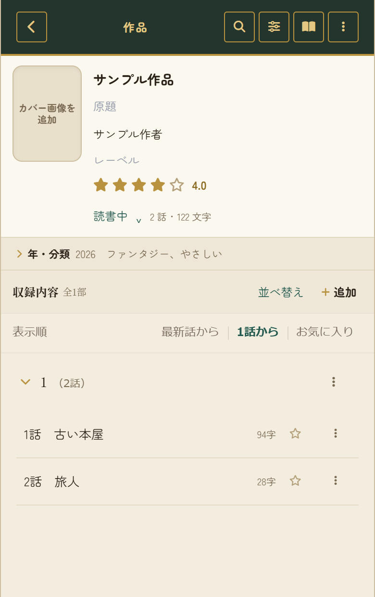
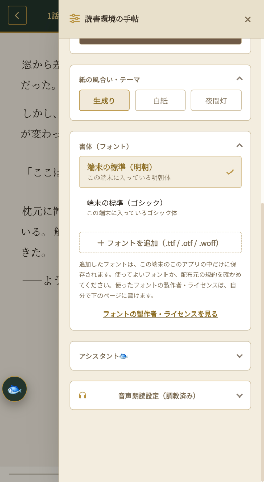
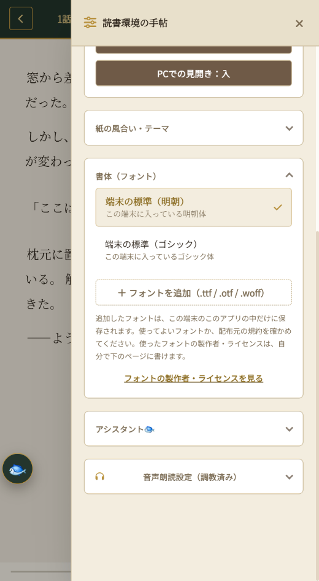
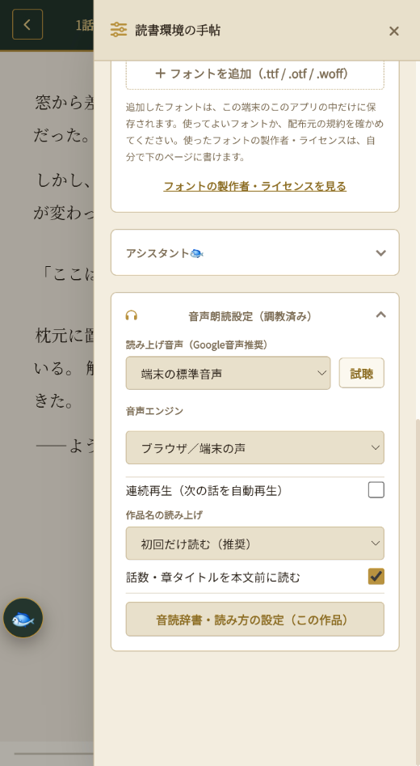

# 読書リーダー(仮) はじめの手引き

> この文書は AI が書きました。画面の名前や場所は、アプリの更新で変わることがあります。

まずは、これだけ読めば、使えます。Google Drive の設定は、要りません。

## 1. 開く

- ブラウザで、アプリのアドレスを開きます。
- スマホは、ブラウザのメニューから「ホーム画面に追加」を選ぶと、アプリのように使えます。

## 2. 作品を入れる

- 本棚の右下の「＋」を押して、題名などを入れて、登録します。
- 作品を開いて、「追加」から、話を足します。本文は、貼り付けるか、「ファイルから」（Word・テキスト・MD・HTML）で取り込みます。
- 「ファイルから」では、見つかった話の一覧が出ます。入れたい話を選んでから、取り込みます。
- 本棚の上の「田」のマーク（4つの四角）を押すと、本棚の見た目が、「リスト」と「表紙を並べる」で、切り替わります。
- 魚のボタンからは、検索などが開けます。

## 3. サンプル作品を消す（長押しで削除）

- 最初に、サンプルの作品が入っています。必要なかったら、消してください。
- 消したい作品を、**長押し**すると、選ぶ状態になります。そのまま、ほかの作品も押すと、まとめて選べます（「すべて選択」もあります）。
- 「削除」を押すと、選んだ作品が消えます。「隠す」を押すと、消さずに、本棚から見えなくできます。
- 選ぶのをやめるときは、左上の「×」を押します。

## 4. 読む

- 作品を開いて、話を押します。続きは、次に開いたとき、前に読んだところから読めます。
- 読む画面の右上の歯車で、細かい設定を変えられます（次の項目）。

## 5. 読む画面の細かい設定

読む画面の右上の歯車を押すと、「読書環境の手帳」が開きます。

- **文字サイズ・行の間隔**：一番上の「−」「＋」で変えます。
- **読み方**：「縦スクロール」と「ページめくり」を選べます。ページをめくる動き、話のあいだに次の話の題名を出すか、パソコンでの見開きも、ここで入れたり切ったりします。
- **紙の風合い・テーマ**：「生成り」「白紙」「夜間灯」から選びます。
- **書体（フォント）**：端末に入っている明朝体とゴシック体から選びます。自分のフォントを足すこともできます（使ってよいフォントか、配布元の規約を確かめてください）。
- **アシスタント（魚）**：魚のボタンについての設定です。
- **音声朗読設定**：読み上げの声、音声エンジン、次の話の自動再生、作品名や話の題名を読むか、などを決めます。

## 6. バックアップ（大事です）

- 作品は、使っている端末のブラウザの中に保存されます。ブラウザの保存データを消すと、作品も消えます。
- ときどき、本棚の上の歯車（全体設定）から、「作品・Wiki・設定をJSONで書き出し保存」を押して、ファイルを保管してください。
- 戻すときは、同じ画面の「JSONファイルから読み込み」で、ファイルを選びます。
- Google Drive との同期は、おまけです。むずかしければ、しなくて大丈夫です。

## 7. 困ったとき

- 古い画面が出るとき：魚のボタンの「最新版にする」、または、全体設定の「アプリの更新」の「最新版にする」を押します。
- わからないことがあれば、作者に聞いてください。

## もっと知りたいとき

- 使い方（くわしい）：`docs/usage.docx`
- 特殊演出の書き方：`docs/effects.docx`
- Google Drive の設定（必要な人だけ）：`docs/drive-setup-easy.docx`（かんたん版）、`docs/drive-setup-detail.docx`（くわしい版）
